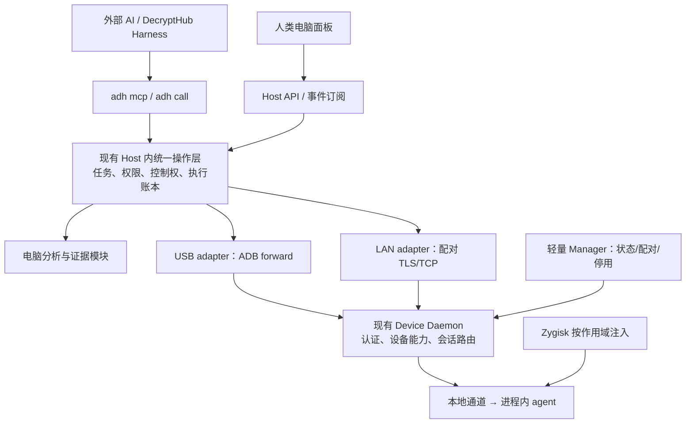

# ADH 代码审计与 AI 优先改造方案

核验日期：2026-11-16。审计基线：ADH `ca4f92ec99e8ec13fc13fbc7f0a24a5919248d6a`；adh-cli `3cf83996cd8a0221b3248048025870f785cd5852`。

> 后续实施校注：同日 P0 已在 Host 源码修复 F01/F02/F04，见 [P0 实施与迁移](P0_HOST_STATE.md)；尚未部署到当前运行服务。本文及 JSON 保留原审计基线与源文件哈希，不重新包装为新代码的实时清单。设备身份等其余发现仍待对应阶段处理。

本文是 `DEVELOPMENT_PLAN.md` 的审计附录和后续实施输入。当前行为、静态发现、拟议设计分开描述；新模块与新命令均未实施，不代表运行现场已升级。用户本轮明确的产品方向：**AI 自主决定分析流程，人类面板可以查看、修改和接管，USB 与局域网共用设备能力。**

## 1. 结论与审计边界

保留 agent、Zygisk、Device Daemon 和 Host 分层，先在现有 Host 内统一操作入口、任务与状态，再补齐设备管理通信。AI 的规划放在外部 Agent/Harness；ADH 不再内置另一套强制分析流程。电脑端面板是同一执行面的人工客户端，手机 Manager 保留配对、状态、撤销授权与紧急停用。

本轮只读取源码、静态解析注册表并写文档。不调用 ADH/ADB、不请求运行服务、不启停进程、不改 reverse、不安装 APK/模块、不读目标 dump/捕获内容。没有用运行时 import 获取工具清单。未重新验证真机能力、网络可达性或 ROM 兼容性。

静态清单见 [AI_FIRST_CAPABILITY_INVENTORY.json](AI_FIRST_CAPABILITY_INVENTORY.json)：记录注册项、源码行号、handler 的直接调用、参数名、分组及源文件 SHA-256。TypeScript 用 AST 解析，Python/Kotlin/C/HTML 用限定文本扫描；不执行业务模块。

| 静态入口 | 数量 | 解释 |
| --- | ---: | --- |
| MCP 工具 | 91 | `MCP_TOOLS` 的真实注册对象；不代表当前运行 daemon 或目标 agent 支持全部能力 |
| HTTP 路由表项 | 106 | 三个 `routes_*.ts` 数组，含资源、首页、前缀路由；不是 106 种独立分析能力 |
| Agent 宣告操作 | 38 | `ADH_AGENT_OPS`；运行目标必须再查询自己的 caps |
| Device AIDL 方法 | 15 | 本地 Manager→特权服务；目前不是 LAN 设备 API |
| Python CLI 子命令 | 7 | connect/disconnect/devices/status/tools/mcp/call |

`/<package>/mcp` 与包固定首页是 router 的额外分支，不计入 106 项。HTTP 条目未声明 method 的标为 `*`，并不表示只读。HTML literal fetch/路径统计会漏动态表达式，不能当作按钮覆盖率。直接调用名不是跨函数的完整执行图。

## 2. 需要优先处理的源码发现

| 编号 | 源码确认的行为 | 影响与优先级 |
| --- | --- | --- |
| F01 | Host `scope_list.ts:302` 的 `writeScopePackages()` 只序列化 version/mode/packages，再用 adb cp 覆盖文件；Device `ScopeJson.kt:8` 会保存 policy | **P0**：Host 改包名单会丢掉手机已保存的非默认 Hook policy，回到默认 crypto ON 语义。这里是字段丢失的静态证明，本轮没有写真机复现 |
| F02 | MCP `settings` handler 只 merge/save；REST `/api/config` 与 settings/import 还调用 retain 和 `applyCaptureEnabled()` | **P0**：相同配置从 AI 与面板提交，运行效果不同；REST 修改还可能影响所有在线目标。必须共用配置应用函数与结果模型 |
| F03 | `AgentSession` 无 deviceId；`process_list` 返回 agent sessions；`pickSid()` 默认从全部在线会话选主进程；多个 root/ADB 模块依赖全局 serial | **P0**：设备、连接、目标进程混用，不能据此可靠支持多设备或跨 USB/LAN 去重。包固定路径也不能替代权限或设备身份 |
| F04 | `state.ts` import 会 mkdir、加载配置/工件、回填元数据、按年龄裁剪捕获；`index.ts` 启动及定时回收工件、每 15 秒重设 reverse | **P0**：只想读取注册表或启动旁路服务，也可能触发数据或连接变更。仅设 ADH_DATA_DIR 不能隔离正常模式的 CAPTURES 路径 |
| F05 | hello 后 `applyStartupHooks()`→`startCaptureLoop()`；默认 capture.enabled/autoDumpDex 为 true；作用域读取失败时 auto-arm 存在 fail-open 路径 | **P1**：发现连接和执行策略耦合；重连不是纯状态操作。需迁入显式、可查询的启动方案，保留已授权任务的必要行为 |
| F06 | `pending`/`inflight` 是内存表，sendCmd 超时只删除等待并报告终态；MCP notifications/cancelled 直接返回 202 | **P1**：超时和取消通知都不能证明目标已停止。缺少可持久化的任务控制、跨入口控制权与不确定执行状态 |
| F07 | 文档称 Web 只读，`public/index.html` 实际已调用 config、settings/import、data/clear、unpack/run 等写入口 | **P1**：规则与实现漂移。人工操作面板已有部分基础，应接入统一执行层；无需另造一套业务后端 |
| F08 | agent 用 loopback→保存的 Host IPv4 回拨；scope、进程控制、诊断、root_watch 等仍直接执行 ADB | **P1**：采集 TCP 可走 LAN，不等于完整 LAN 独立控制。重构必须覆盖全部 ADB 消费者，不能只让 process_list 通过 |
| F09 | `/api/trace/qbdi`、`/api/unpack/trigger`、hook/selftest 未限定 POST；handler 会执行目标操作 | **P1**：HTTP 方法不能充当副作用分类。需逐 action 描述效果，再统一到写操作执行入口 |
| F10 | Python `adh` 与 daemon/src/cli.ts 是两套命令入口；前者 devices 保存 Host 地址，后者提供 doctor/target/unpack | **P2**：用户概念和目标解析分散。保留已发布 stdio 入口，逐步把公共命令收敛到 adh-cli，开发 CLI 薄兼容 |

关键复核点：[scope 写入](../daemon/src/scope_list.ts)、[MCP](../daemon/src/mcp.ts)、[REST 配置](../daemon/src/http/routes_system.ts)、[状态与加载](../daemon/src/state.ts)、[启动](../daemon/src/index.ts)、[执行与采集](../daemon/src/service.ts)。F05 的默认值不代表当前现场配置；本轮没有读取现场 settings。

当前两处 family 配置也不能混为一谈：Device `CaptureFamilies` 决定哪些 Hook **根本不安装**；Host `settings.capture.families` 在接收侧过滤记录，不能证明相应 Hook 已卸载。新的面板需分别显示方案、实际安装和输出过滤，避免用户关闭显示后误以为停止了目标观测。

## 3. 能力对照

以下 20 组完整覆盖 91 个 MCP 注册项，每项只归一组；逐项名称、参数和调用位置在 JSON。Python `adh call`/`adh mcp` 能转发全部注册工具，不表示有对应专用子命令。REST 列描述直接路由，不把 `/mcp` 的间接可达重复算作 REST 对等。面板列只确认源码中的现有入口，不声称本轮浏览器验收通过。

| 能力组（MCP 数） | AI / CLI 当前入口 | 电脑面板 / REST 当前情况 | 手机侧与副作用 |
| --- | --- | --- | --- |
| 分析指南（1） | analysis_guide，含 assess | 无独立指南面板；可经 MCP | Host 元数据；assess 可有界查询 Hook 状态，不执行建议 |
| 目标与能力（3） | process_list/backends/capabilities | agents/backends/capabilities | 列 agent 会话，不是物理设备或所有 Android 进程 |
| 诊断与自检（5） | runtime_diagnostics、compat_probe、ping、engine/protocol_selftest | 有 ping/probe/selftest 等；root 诊断缺直接 REST 对等 | 诊断走 ADB/root；自检可能临时安装 Hook/分配资源，应单独标效果 |
| 作用域与启动（3） | scope_list/scope_set/analyze_app | scope、analyze-app REST | Manager 可本地编辑 scope/启停；analyze_app 缺在线 agent 时会 cold-start，并可加作用域 |
| 采集与网络（8） | capture_start/stop、live_captures、capture_detail、http_exchanges、flow_correlate、file_probe、crypto_identify | 捕获/HTTP/配置/文件探测等；面板可改全局采集配置 | 安装/卸载 GOT Hook，drain 消耗 ring；网络重组在 Host |
| 检测观察（3） | detect_summary/modules/java | 有 summary，部分安装能力仅 MCP | 检测 Hook 会改变目标执行环境；不把观察结果等同于反检测结论 |
| Java（6） | javahook_probe、java_hook/enum/call/call_result/trace | probe/hook/enum/call/trace REST | agent ART/JNI 机制；call/trace 主动执行，兼容性取决于运行构建和 ROM |
| JNI（4） | jni_onload/hook/env_hook/field_digest | 对应 JNI REST | 注册、表槽 Hook/事件读取；宽匹配可能耗尽事件预算 |
| Native 运行时（8） | native_hook/hook_all/look/call/backtrace/symbols、got_enum、stealth | hook/call/backtrace/stealth 等；并非全组独立 REST 对等 | GOT/inline Hook、参数改写、主动调用和返回控制；符号解析在 Host |
| 内存（9） | maps/maps_query、read/search/scan/disasm、write/restore、mem_backend | 多数有直接 REST；高级 maps_query 无同名路由 | 写入最多 4096 字节；force 可临时改保护；undo 是 Host 内存记录，不是持久事务 |
| 观察与追踪（8） | root_watch、hw_watch、trace_session、qbdi_trace、syscall_trace/watch/digest、trace_digest | 一部分 trace/syscall REST；无 root_watch/trace_session 直接同等路由 | root_watch 外部 helper 走 ADB；QBDI 主动调用与 Hook 回放必须区分 |
| 模块（2） | module_watch/load_library | module/watch、agent/load_so | watch 状态与 dlopen 有副作用；不是单纯读取模块列表 |
| 活体对象（3） | object_inspect/set/invoke | 对应 REST | set 改值；invoke 执行方法；inspect 也依赖活体运行时访问 |
| DEX（11） | art_dexfiles 与 dex_search/index/index_search/reflections/xref/crypto_scan/method_code/repair/coverage/recover | DEX/ART REST；还有 strip/rebuild/parse 等 REST-only 操作 | ART 枚举在 agent；解析/索引/修复在 Host，可写索引与新工件 |
| Native 离线分析（6） | native_xref/disasm/analyze/crypto_const、crypto_variant_scan、native_syscall_scan | 多数有对应分析路由；native_xref 无同名入口 | Host 解析/反汇编；临时文件与缓存也要归属任务 |
| 工件（4） | dumps_list/memory_dump/dump_all_dex/unpack_package | dump/download、模块 dump、unpack/inventory/run 等 | dump 落盘并可能触发保留策略；unpack 可启停目标、暂停采集、保护自动布防 |
| 证据与 oracle（2） | crypto_evidence/oracle | 缺直接同等 REST/专用面板 | Host 保存原始配对证据；oracle record/replay 主动调用 Java 门面；drop 删除文件 |
| Host 控制（2） | settings/recipe | 配置/导入/导出、recipes/run | 设置全局共享；recipe 可多步骤写入/调用，应返回每步真实效果 |
| 文件（2） | fs_list/fs_read | 面板及 REST 还支持无 session 的包沙盒路径 | agent 自身权限读取，或 Host 通过 ADB/root 读取；两条路径权限不同 |
| 主动触发（1） | trigger | unpack/trigger | 调用目标函数；当前 REST 允许查询参数驱动执行，不能按 GET 视作只读 |

未被 91 个 MCP 项完整覆盖的产品能力：

- **设备清单、设备属性、已安装应用/图标**：Device AIDL 有本地应用目录；Host 没有统一物理设备服务；process_list 不能代替它。
- **证书生命周期**：listCaCerts/putCaCert/deleteCaCert/rebootDevice 共四个 AIDL 方法，Manager 有页面，公共 CLI/MCP 无同等受管入口；系统 CA 与应用证书校验 Hook 分开。
- **持久任务、控制权、取消、断点、结果关联**：目前有命令进度与事件日志，但不足以组成可恢复、可接管任务。
- **数据生命周期**：面板/REST 有清理和导出，MCP settings 能改部分策略，但没有统一的维护任务模型。
- **自定义分析代码**：外部 Agent 可使用自己的终端、Python/Capstone/仿真器；ADH 不是通用 JS 脚本引擎。新执行机制应独立评估，不能以双传输重构为由默认引入 Frida/Gadget。

## 4. 状态、写入者与副作用清单

| 状态/资源 | 当前所有者与存储 | 当前写入者/触发 | 一致性或副作用问题；迁移目标 |
| --- | --- | --- | --- |
| 设备身份与连接 | 缺统一实体；ADB serial/env、Host endpoint、session 分散 | Host 连接与工具各自选目标 | 增 Device/Connection/Target 三实体；同设备 USB/LAN 去重，禁止有歧义的默认选择 |
| 注入 scope 与 family policy | `/data/adb/adh/scope.json`；Kotlin core 定义，C++ 手工镜像 | Binder 整体替换；Host ADB 只写 packages | F01；改为设备端单写入者、带版本 patch，保留未知字段和逐包策略，冲突拒绝 |
| 手机 Hook 编辑草稿 | Manager ScopeDraft 与 ScopeRepository | 人类页面修改并保存 | 无跨电脑/手机 revision；保存前需检测旧草稿冲突 |
| Host 回拨地址 | `/data/adb/adh/host.endpoint` | Manager→Binder；Zygisk 读取并传给 agent | IPv4 单地址；不是手机设备地址。新 broker 建立后保留为 legacy 回拨配置，分清方向 |
| CA 与生效挂载 | cacerts 目录、启动脚本的 tmpfs/bind mount | Manager→特权服务，启动脚本，reboot | 安装到磁盘不等于所有进程已信任；报告 pending-reboot/有效挂载；私钥不进入普通事件 |
| 模块/QBDI 可选载荷 | module.prop、开机标记、qbdi.enabled、Zygisk fd | 构建/部署脚本、启动脚本、companion | 部署与启用不同；版本/能力按实际目标上报，不热换正在执行的 .so |
| session/caps/socket | Host state.ts 内存 Map | hello/caps/disconnect/prune | PID/UID/starttimeTicks 已存在，应保留；补 deviceId/bootId/connectionId；重连 SID 变化不丢任务绑定 |
| pending/inflight | Host Map、cmd.start/progress/done | sendCmd、超时、断连 | 仅请求生命周期，无 actor/task/fencing；超时不能确认目标没执行；接入操作账本 |
| 全局 settings | state.ts 内存与 DATA_DIR/settings.json | MCP merge/save、REST 配置/导入 | F02；先改内存再存盘，save 非原子；需统一提交、版本、持久化与实际应用分开报告 |
| 启动 Hook 与采集定时器 | startupHooks、captureTimers、延迟 widening | hello、applyStartupHooks、startCaptureLoop | 连接有隐式执行；迁为有 owner、显式启用的启动方案；状态浏览不触发安装 |
| 采集停止/解包保护 | service.ts 的 pending/protect/suppression 等内存集合 | setCapture、unpack、hello | 多处按 package 键控，未来须加 device；保护不能丢，否则重连可能重新布防 |
| 实际 Hook/断点/回放 | agent .so 的运行时表、ring、QBDI 页 | 所有 Hook/trace 类操作与自动布防 | 方案 desired 与 agent observed 分开；读实际 Hook ID、模块 build-id、安装结果，禁止只显示配置已保存 |
| 内存写 undo | service.ts writeUndo，按 session+addr，每 session 64 项 | memory_write/restore | Host 重启丢失；不能自动覆盖之后的人类/目标改动。恢复前校验进程代次及当前字节，支持条件恢复 |
| 捕获记录与计数 | captures 内存、每包 captures.jsonl、capStats | drain 消耗 agent ring，push/trim/age-prune | retain/年龄会丢记录；每包键需要 device/任务隔离；保留丢失计数和窗口基线 |
| dump 与来源元数据 | CAPTURES 下 bytes/.meta.json、dumps Map | dump/persist/load/backfill/prune | 正常 CAPTURES 固定仓库目录，与 DATA_DIR 分离；统一 StorageContext 后显式迁移，加载不删除 |
| 事件与设置回放 | DATA_DIR/events.jsonl，内存 events | recordEvent、启动载入、REST clear | 不是完整操作事务；任务操作日志独立保存 actor/请求/结果引用，不能靠清展示事件抹掉执行记录 |
| DEX/ELF 索引与缓存 | Host 分析模块、缓存/工件关联 | index/analyze、工件回收 | 派生数据可重建，原始证据受任务 pin 保护；失效时不能清掉唯一证据 |
| trace/evidence/oracle | DATA_DIR 下各模块文件与局部缓存 | record/replay/query/drop | 能力已有；统一任务关联、权限、保留与分页，不重复写一套证据引擎 |
| root_watch 执行 | Host runs Map、ADB 子进程、设备 helper、Host JSONL | prepare/start/stop | prepare 上传+chmod+硬件自检；start 验代次并占用断点；stop 终止 collector。全 LAN 需替换这些 ADB 步骤 |
| CLI 已存 Host | adh/config.py 的 connections.json | connect/disconnect | devices 实为 Host 列表；保留旧 schema/语义的兼容期，不静默把 Host 地址解释为手机地址 |

重点源码：[内存/命令](../daemon/src/service.ts)、[capture 持久化](../daemon/src/capture_persist.ts)、[root_watch](../daemon/src/root_watch.ts)、[设备 Binder](../device/daemon/src/main/java/com/adh/daemon/RootScopeBinder.kt)、[证书挂载](../injector/zygisk/module/post-fs-data.sh)。

副作用需要按 **action + 参数** 描述：native_hook.status 和 install 不同；trace_session.query 与 record 不同；crypto_evidence.verify/save/drop 不同；“读取采集”也可能 drain ring。建议效果集合为 `host-read / host-write / device-read / device-config / target-observe / target-mutate / target-invoke / process-control / maintenance`，并声明资源占用、可取消方式、可恢复条件；不是一把 readOnly 布尔值。

## 5. 目标架构与 AI/人类协调

### 5.1 一个执行面，AI 自主规划

- 现有 Host 进程内增加协调模块，不新建队列服务/数据库服务器；MCP/REST/CLI/面板调用统一业务函数。业务原语继续复用现有 service/analysis 模块。
- 91 工具逐 action 登记能力和效果。先保留稳定工具名，handler 逐步变薄。面板常用能力使用表单，高级能力可使用同一 schema 的参数编辑器；AI 不受按钮数量限制。
- 授权按任务的设备、应用、目录与允许效果授予；授权内自主组合、批处理、运行实验，避免逐工具确认。当前 confirm:true 是调用意图标志，不可当作身份鉴权。
- actor 从已认证的入口和服务端任务授权取得，不能信任 AI/页面在 JSON 中自称 human。Host 本地接口与远程接口都要纳入权限检查；现有公开 HTTP、宽 CORS 不能直接承担高权限任务授权。
- 自定义 Python/反汇编/仿真任务由外部 Harness 或 Host worker 运行，可登记 task/operation/资源与产物。带外 adb/shell 无法凭空获得完整可追踪性；受管执行提供 wrapper，发现外部改动后刷新 observed 并使旧计划失效。

### 5.2 共享状态与人工接管

- `Task` 保存目标、任务授权、当前方案引用、阶段/实验摘要、operation 与 evidence 引用。AI 可以随时更新分析路线；不要求先固定完整 DAG。
- `TargetRef` 至少绑定 deviceId、bootId、PID、UID、starttimeTicks；模块操作另绑模块 build-id。`Connection` 是可更换传输，不是设备身份。旧 agent 缺字段时显式标 legacy/identityUnverified。
- desired 配置和 observed 运行结果分别保存 revision。安装部分失败、只保存未应用、待重启、离线未知均有明确状态。
- 事件保留来源时间、接收时间、游标所属顺序域、完整性与快照来源。root_watch 的分页 seq 不是跨槽执行顺序，异步读取的目标内存也不是命中瞬间快照；统一事件模型不能抹掉这些区别。
- 首版按目标进程串行调度冲突写操作；设备配置另锁设备。独立只读/离线分析可以并行，后续再细化到 Hook/内存范围；不用一把全局锁阻塞所有设备。
- 人类修改提交新 revision、推进控制 epoch，暂停受影响任务的后续冲突写入并发事件。AI 旧请求在执行层返回 conflict，重读并重规划；不能自动把人工关闭的 Hook 又开回来。
- Host 阶段只能阻止尚未派发的旧请求，不能撤回已在 agent 执行的命令。新协议在执行端检查 epoch 后，才可声明跨重连拒绝旧命令。UI 必须区分这两个保证。
- pause 停止新派发；cancel_requested 表示已请求取消；仅在执行端确认停止后记录 cancelled。不可取消的在途调用继续报告 running/unknown，不能伪造“已停止”。

拟议请求元数据：`taskId / operationId / idempotencyKey / TargetRef / expectedRevision / controlEpoch / deadline / arguments`。拟议状态：`queued → running → succeeded | failed | cancelled | unknown`，另有任务 paused。超时但已派发的副作用操作记 unknown，通过状态核对解决，禁止自动重放 native_call/Java 调用。不能承诺跨崩溃的任意副作用 exactly-once。

### 5.3 Hook 方案与证书

电脑持有版本化 Hook 方案与预设；agent 保留 Native/JNI/ART 执行机制与能力上限。新增目标、过滤、采样规则尽量只改方案；新增底层执行机制仍需 agent 发布，不能承诺“任意 Hook 永不升级手机”。

早期 Hook 使用电脑下发、明确启用、绑定包/版本/能力的设备缓存方案。缓存需原子提交、校验哈希、可撤销、记录 applied/failed；断线保留策略写入方案。现有 Host hello 布防无法覆盖 .init_array，更早执行不能仅靠缓存文件声明支持，须在 agent/Zygisk 专用路径另行验证。

先保留并完整迁移现有 policy；等方案覆盖、兼容和启动路径验证完成，再移除手机固定 family 编辑器。Agent 重连默认只对账，是否安装由显式任务/启动方案决定，不能偷偷恢复旧全局默认。

CA 安装/删除、挂载状态、待重启与重启操作由设备域服务执行，CLI/MCP/面板共用它。设备传输配对证书和用于目标抓包的系统 CA 必须分开；不把配置写成功当成目标已信任。

### 5.4 USB 与 LAN 的真实统一范围

- USB 使用 Host→Device RPC 的 ADB forward，LAN 使用同一 Device RPC 的配对 TLS/TCP。上层选 deviceId，两种 adapter 只负责连接/断连/流传输，不各写一套业务逻辑。
- 优先扩展现有 Device Daemon 的逻辑模块，不另起一个同职责 root daemon。设备目录、应用目录、scope、证书、进程控制先通过同一域服务提供；Binder 继续服务本机 Manager。
- 当前 Binder 只允许经签名/UID 校验的 Manager，不能直接开放到 TCP、伪造 Manager 身份或删除 verifier。把域操作从 RootScopeBinder 提取，Binder 和网络入口分别认证后调用。
- agent 改连设备本地通道，Device 只路由/执行，不做 MCP、索引或重分析。Unix socket 的 SELinux、UID 验证、Zygisk specialization 前后 fd 生命周期、服务未就绪行为必须先在专用 fixture 验收；本轮不声称各 ROM 已支持。
- 控制与 bulk 数据分流或有界复用，dump/trace 分块、背压、丢失计数和校验；设备不把大块数据长期积压到 Java 堆。断线时有限缓冲，如实报告缺口。
- root_watch helper 的部署/运行/停止、procfs 诊断、沙盒文件读取、应用启停、scope、模块/QBDI 状态都需要 Device adapter；遗漏任何一项都不能称“全功能 LAN”。不恢复已退休的手机 UI 自动化模块 X。
- legacy agent→Host TCP/reverse 保留为明确选择的兼容后端；旧目标保持连接至任务结束。新通道先用独立 fixture/隔离端口验收，不在现有 session 上热切。

## 6. 具体模块改造表

下列新增路径均为建议，不是本轮已落地代码。

| 位置 | 改造职责 | 复用/兼容要求 |
| --- | --- | --- |
| `daemon/src/operations.ts`（新增） | OperationSpec、按 action 效果/资源、统一 execute/查询、统一错误 | MCP/HTTP 只做协议转换；保留原语，不一次重写 91 handler |
| `daemon/src/tasks.ts`、`task_store.ts`（新增） | Task/Operation 持久状态、事件游标、幂等记录、任务/证据关联 | 首版用 Host 原子文件/追加日志即可；崩溃恢复先对账，不自动重放副作用 |
| `daemon/src/control.ts`、`access_context.ts`（新增） | revision、目标级调度、control epoch、人工接管、任务授权 | 身份从认证边界传入；Host 和设备执行端逐步补 fencing |
| `daemon/src/host_lifecycle.ts`、`storage.ts`（新增） | 显式 init/start/stop、StorageContext、非破坏性恢复、独立 retention job | state import 不 I/O；CAPTURES/DATA_DIR 同根可配置；旧数据先只读导入/备份，不移动删除 |
| `daemon/src/state.ts` | 拆类型/仓储状态与启动 I/O；为设备/目标/任务分键 | 保留旧事件/工件读取；采集 complete/drop/来源语义不降级 |
| `daemon/src/service.ts` | sendCmd 接操作上下文、状态与取消能力；capture/startup/undo 接统一操作层 | 先加 facade，再逐域拆；超时 unknown，条件 undo，实际应用结果可查 |
| `daemon/src/settings_service.ts`（新增） | 共用读取/patch/持久化/运行时应用 | 首先修 F02；返回 persisted/applied/failed/affectedTargets，不把全局设置自动扩散当成功 |
| `daemon/src/devices.ts`、`transport/*.ts`（新增） | 设备注册、发现、选择与 USB/LAN/legacy adapter | 将 serial 从进程 env 下沉为每次 TargetContext；重连去重与代次校验 |
| `scope_list.ts`、`app_launch.ts`、`sandbox_fs.ts`、`runtime_diagnostics.ts`、`root_watch.ts` | 通过 DeviceClient 做设备控制、读文件、诊断、helper 生命周期 | 列出并迁完所有 ADB 消费者；legacy ADB adapter 仍显式可用，业务模块不自行择设备 |
| `mcp.ts`、`http/routes_*.ts`、`error_codes.ts` | 统一 OperationSpec、效果说明、分页/限额、错误与任务接口；取消映射 | 稳定工具名优先；副作用 GET 逐步迁 POST，兼容层也走同一执行检查 |
| `daemon/public/index.html` → `public/app/*`（按需拆） | 设备/任务/实际 Hook/证据、方案编辑、暂停/接管、冲突提示 | 先贯通一组真实操作；复用现有显示，不先做整站视觉重写 |
| `device/core/...` | Device/Connection/Target 与协议能力、版本化配置 patch 契约 | Kotlin/C++ 路径与 schema 同步；保留旧 policy、未知字段策略与版本拒绝机制 |
| `device/daemon/.../DeviceOperations.kt`（新增）及 `RootScopeBinder.kt` | 设备域单写入者，Binder/network 共用；scope CAS、证书/应用/进程操作 | 保留 ManagerCallerVerifier；原子写入不等于并发版本检查，两者都要 |
| `device/daemon/.../rpc/*`（新增） | 配对/撤销/鉴权、USB/LAN 同协议、会话路由/限额、helper runner | 不放分析/MCP；root helper 按授权/载荷哈希登记，不能暴露匿名任意 root shell |
| `device/manager/.../data` 与 `ui/*` | 同一设备状态源；方案/授权状态、配对、停用，逐步退役固定 family 编辑器 | 手机本地操作同样产生 revision/事件；断开电脑仍能撤销/停止 |
| `agent/src/bootstrap/io.c`、`agent_main.c`、caps/dispatch | 本地传输与协议握手、代次/epoch、可报告的取消/安装状态 | 38 旧 op 的语义保持；新增能力如实协商，不为改通信把分析塞进 .so |
| `injector/zygisk/jni/main.cpp`、启动脚本 | 设备本地连接引导、已授权启动方案交付/撤销、fd/SELinux 生命周期 | 不热改旧进程；agent/模块版本及 exports 契约一起验证 |
| `adh-cli/src/adh/{cli,status,endpoint,http_mcp,stdio}.py` | 统一公共 CLI；hosts/device/tasks/hook/cert；JSON、任务/事件查询 | 保持零第三方运行依赖；新传输的 TLS 在 Host，CLI 仍 stdio→Host；旧连接配置显式迁移 |
| `daemon/src/cli.ts` | 开发命令薄兼容/逐步退役 | doctor/target/unpack 迁入公共 CLI；不增加第二个 mcp 子命令 |

桌面端消费边界已经只读核对：`DecryptHub-DSH/packages/mcp/decrypthub-components/src/inventory.ts` 只解析 schemaVersion=1，`index.ts` 调用 status --json，并把旧 devices 配置当 Host endpoints。新增设备/任务字段需同步 parser/types/测试；不能直接输出 v2 导致桌面卡片失败，也不能假设未声明字段会保留。先提供显式 v2 协商、默认保留 v1，消费者迁移后再切默认。公共 devices 语义同样需要兼容期：先增加 hosts 与 device list，不能静默改旧 JSON 含义。此轮没有修改跨仓契约。

## 7. 实施顺序与验收条件

| 阶段 | 实施范围与交付 | 通过条件 | 依赖/现场安排 |
| --- | --- | --- | --- |
| P0：保护数据与修一致性 | 显式生命周期/StorageContext；scope 保留 policy；统一 settings 应用；效果清单 | import/列表不删证据、不改隧道、不装 Hook；非默认 policy 往返保留；同一 patch 经 MCP/HTTP 得到相同状态与失败结果 | 最先做；纯 Host 测试/合成配置；不升级运行实例 |
| P1：共享操作与任务核心 | OperationSpec、任务账本、revision/Host 控制权；现有 REST/MCP 逐步接入 | 同幂等键不重复派发；冲突操作串行；人类改动阻止旧排队请求；超时/取消真实；旧入口没有写入绕路 | P0 后；fake agent/隔离端口；AI 自主规划，recipe 可选 |
| P2：人类接管最小闭环 | 任务/Hook 方案/运行状态/证据界面，AI 任务事件；基础 device/target 实体 | AI 安装→面板见实际 Hook→人工关闭→旧 AI 操作 conflict→AI 重读继续；暂停不再发新写；未知执行状态可见 | P1 后；先测 fake agent，再独立 native fixture；此时先用 legacy 设备后端也可验证协作 |
| P3：统一设备控制与 USB | 提取 DeviceOperations、scope/证书/应用/进程服务、设备身份；USB forward 设备 RPC；agent 本地通道原型 | 设备离线/无目标仍可列出信息；两个设备不串；Binder/RPC 结果一致；UDS/fd/SELinux 原型通过；无分析进设备 | P1 后，可与 P2 独立开发；专用 fixture/新测试进程，保留所有当前 session |
| P4：LAN 与完整能力对等 | 同一 RPC 上的 TLS/配对/撤销；迁完诊断/fs/helper 等 ADB 调用；流式 bulk、断线对账 | 撤去测试设备 ADB 可达性后，设备清单、scope、证书、目标操作、诊断/root_watch/dump 均能工作；USB/LAN 对同 deviceId 去重；无重复调用；撤销授权有效 | P3 后；仅隔离测试设备/连接。未迁能力明确 unsupported，不能悄悄走 ADB 后宣称 LAN 通过 |
| P5：Hook 方案与公共入口收敛 | 电脑方案库、经验证的早期缓存、手机编辑器退役；公共 CLI、桌面 schema 迁移；旧默认与文档收口 | 新/旧配置迁移可逆；缺能力/旧协议明确拒绝；未授权方案不自动安装；断线策略按方案执行；CLI/面板/AI 同效果；早期能力有真实路径证据 | P2/P4 后；运行任务结束后再安排产品升级，兼容窗口内不删除 legacy |

每阶段是一组可独立评审的提交，先做完整的一小组操作再扩展覆盖。P2 的闭环先选择可查询、可卸载的 native Hook，不用重启现有目标证明接管。两层验证分开：Host 合成协议检验协调逻辑；后续专用真实第三方目标检验注入/ROM/传输，不用沙盒通过代替真实目标证据。

P4 核心对等矩阵：设备信息/应用清单、scope patch/冲突、Hook install/status/remove、内存读写/条件恢复、主动调用不重试、dump 分块哈希、事件丢失计数、root helper 生命周期、证书 pending-reboot、重连代次、撤销授权。对每格分别记录 USB/LAN pass/fail/unsupported；有副作用的项仅在测试目标和授权范围内执行。

## 8. 规则同步、迁移与尚未验证项

- 用户方向明确改变“电脑面板只读”的旧产品定位。进入相应实施阶段时同步 `REQUIREMENTS.md`、`DEVELOPMENT_PLAN.md`、`AGENTS.md`/`CLAUDE.md`、device/MAP 与工具说明，保留 agent 轻量、分析在 Host、模块 X/Gadget 退休等有效边界。当前审计没有把这些规则静默改成已实现状态。
- 不改现有 scope 路径、默认端口、stdio onboarding 或桌面 status schema；本轮只记录所需迁移。协议、配置、消费者变更在对应阶段一起提交与验证。
- 旧运行会话保持旧后端至自然结束；新 Host 先用独立端口/独立全部数据根/fake transport 验收。不能在旁路服务里运行自动 reverse，也不能共享真实 captures 根。
- 仍需未来实验：手机本地 socket 在目标 ROM 的 SELinux/UID/fd 可行性、Device Daemon 大数据转发开销、执行端取消和 epoch 覆盖、启动早期 Hook 的可达时机、完整断线对账、TLS 配对生命周期、多设备真机隔离。本轮只给设计与静态证据。
- 生命周期初始化与任务日志迁移必须先预览/备份；只读恢复不执行年龄删除。保留策略作为可见维护任务运行，任务引用的原始证据有 pin，所有删除带清单和原因。

## 9. 本轮检查记录

本轮结果：静态清单与文档一致性 **9 passed / 0 failed**；`npm run typecheck` 退出 0；`npm test` **464 passed / 0 failed / 0 skipped**；`git diff --check` 通过。

静态检查覆盖：工具唯一性、20 组无遗漏/重复、路由/agent/AIDL/CLI 数量一致、清单中全部源码 SHA-256 未变、MCP 行号定位、文档链接存在、F01–F10/P0–P5 齐全，以及 F01/F02 的源码结构证据。它们不冒充真机集成测试。

Host 单测启动前在子进程设 `ADH_SKIP_ARTIFACT_LOAD=1` 并移除继承的 `ADH_DATA_DIR`，沿用既有 launcher 的每测试进程临时数据根，避免加载/裁剪操作者捕获目录。没有运行设备验收、注册表动态导入脚本或完整设备门禁，没有启动服务。新增清单和报告不改变任何运行功能。
