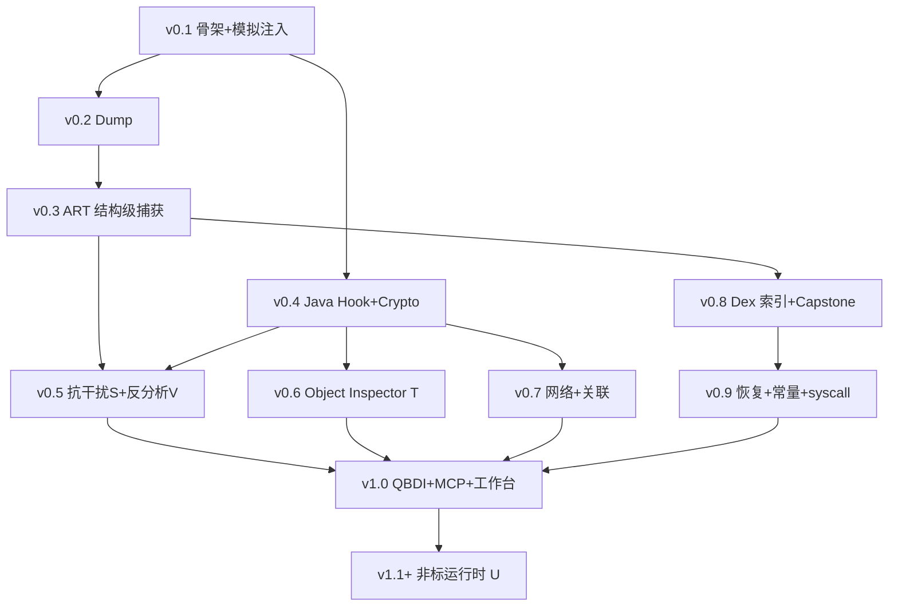

# ADH (Android DecryptHub) — 开发计划

> **定位**：**通用 Android 运行时逆向分析工具** — 对高对抗目标（反调试/root/签名检测/混淆/加密传输）具备实战能力。
> **功能需求**：见 [`REQUIREMENTS.md`](REQUIREMENTS.md)（唯一权威规格，模块 A–W；本文档只管架构与排期）。
> **跨会话进度**：见 [`PROGRESS.md`](PROGRESS.md)。
> **参考项目**：[`REFERENCE_IOS.md`](REFERENCE_IOS.md)（[ios-decrypt-helper](https://github.com/taisuii/ios-decrypt-helper)）。
> **一句话**：运行在目标进程内的 native agent，配合本机 daemon、Web UI 和 MCP Server，实现运行时 dex/so/memory dump、ART 结构级脱壳、Java/native hook、明文边界加密观测、活体对象自省、反分析行为观测、函数/指令 trace、Capstone 反汇编与搜索；Zygisk / Gadget 多种注入方式。

---

## 0. 核心原则（架构红线）

2026-10-24 接入补充：Host `analysis_guide.ts` 提供可查询的工作流模板及 MCP 初始化说明，
让远程 Agent 无需读仓库即可选择真实写入/证据核验/有界追踪/卡点诊断路线。指南只返回元数据，
不自动运行工具、不把分析流程放进 Agent/Device。可达性验收走实际 `adh mcp` stdio 代理。

同日低上下文使用补充：`analysis_assist.ts` 为同一入口提供 assess 模式，把 Host 当前保留状态
和一次有界只读查询解释为阶段/缺口/下一步。判断在 Host，不新增 Agent/Device 分析职责，
不自动执行建议、替选进程或重启，也不以此代替未知样本盲测。

2026-10-24 补充：模块 E/I/V 本轮采用同一分层：Agent 有界采集分页指令与观察计数，
Host 的 `trace_store.ts` / `crypto_evidence.ts` 负责持久化、查询、参数分组和分析；
`runtime_diagnostics.ts` / `proc_identity.ts` 负责只读诊断与代际校验。Web 保持只读。
v123/v125/v126 使用独立 ARM64 memfd 自加载宿主验收，v124 使用可重放的新随机参数挑战。
实际 Android 安装包的更新被自动审批拒绝，不能把原生宿主通过写成已更新 APK/真实目标。
这一片补了有界模块指令记录和 Host 查询；完整内存污点、未知虚拟机自动解码、参数初始化盲定位仍待独立验收。

2026-10-23 补充（模块 E / WS-H）：真实写入追踪可使用可选 `root_watch`。Host 编排外部 root perf
collector，helper 只采内核事件，不放进 Agent 或 Device Daemon/Manager。源码、构建和验收见
`tools/native/root_watch.c`、`tools/build_root_watch.sh`、`verify_v121_root_watch.sh`。
这一片已完成参考设备的 w 验收；不改变“完整 syscall 拦截不做”的决议，也不声称做完块级全量 trace。
先有数据观察点/GPR/内核栈/原语边界的确定证据，再决定是否需要更大 trace；不能把不完整虚拟栈重放
当成真实执行完整录制。京东案例已用这条路径完成带私有参数配置的独立 b5/b6 计算，参数初始化仍待续。

```text
目标 App 进程（libadh_agent.so）：
  最小侵入、低内存、低阻塞 —— hook / trace / dump / 事件采集 / 轻量 RPC

独立守护进程（adhd）：
  HTTP / WebSocket / MCP / 数据库 / 索引 / 任务调度 / 反汇编缓存 / 重分析

Web UI（浏览器）：
  只读查看器 —— 看记录、搜索、看反汇编结果。下任务走 MCP，不在浏览器里配钩子。
```

**禁止**：把 HTTP 服务、WebSocket、MCP、数据库、反编译、Capstone、QBDI 全塞进目标 App 进程。
否则目标 App 极易 OOM、ANR、崩溃，且易被目标进程自身逻辑干扰。

**项目成败三要素**：

1. Agent 轻量、稳定、可控
2. Daemon 负责重活、索引、Web、MCP
3. 所有高风险功能支持过滤、限流、开关、回放

---

## 1. 总体架构

```text
┌────────────────────────────────────────────┐
│              Web UI / Browser              │
│  只读：看记录 / 搜索 / 反汇编结果           │
└─────────────────────▲──────────────────────┘
                      │ HTTP / WebSocket
                      │ MCP（下任务走这里）
┌─────────────────────┴──────────────────────┐
│                 adhd 守护进程               │
│  - HTTP + WebSocket + MCP                  │
│  - 会话、索引、脱壳、Capstone 反汇编        │
│  - native_look：一次原生观察收成一条结果    │
└─────────────────────▲──────────────────────┘
                      │ TCP 8761（adb reverse）
┌─────────────────────┴──────────────────────┐
│         目标 App 进程：libadh_agent.so      │
│  - hook / 命中时拷贝 / dump / 轻量 RPC      │
│  - 不做 HTTP、数据库、反汇编                │
└────────────────────────────────────────────┘
```

手机侧还有一层，不在这条数据通路里：`device/` 的 Manager 管注入范围和目标进程启停，不做分析。

下面 §4 里仍有早期草图（进程内 Capstone、浏览器里配钩子、QBDI 按地址范围跟踪）。那些不是现在在跑的设计。QBDI 的现行口径在 §6.9.1 WS-H：可选，起不来就跳过；真实调用点用 `native_hook`。

### 1.1 三层职责边界

| 层级 | 组件 | 做什么 | 不做什么 |
|---|---|---|---|
| L1 | `libadh_agent.so` | hook、trace、dump、maps 扫描、事件推送、执行 RPC 命令 | HTTP/MCP、DB、索引、smali 生成、大量反汇编缓存 |
| L2a | Host ADH Daemon (`adhd`，PC) | Web/MCP 服务、会话、调度、存储、索引、分析、缓存 | 注入目标进程、直接读目标内存 |
| L2b | Device surface (`device/`) | Manager Compose + Device Daemon 作用域/模块状态/目标进程启停 | 分析、HTTP、MCP、hook |
| L3 | Web UI | **只读查看器**（2026-10-01 冻结）：观测、搜索、可视化 | 业务逻辑、直连 Agent、配置写入、导出 |

### 1.2 外部依赖

| 库 | 角色 | 部署位置 |
|---|---|---|
| [Dobby](https://github.com/jmpews/Dobby) | arm64 native inline hook（by address；静态链接） | Agent（`tools/fetch_dobby.sh`，已验证 v2.2/v28） |
| [Capstone](https://github.com/capstone-engine/capstone) | 反汇编引擎 | Daemon 为主；Agent 可选轻量 wrapper |
| [QBDI](https://github.com/QBDI/QBDI) | DBI 框架，指定范围 instruction trace | Agent **可选**（按需加载；起不来按 `SKIP:optional-dependency`） |
| ~~Frida Gadget~~ | **已退出产品面**（2026-10-20） | 历史脚本可留在 `tools/`，不进 UI / 门禁 / 发布物 |
| Zygisk (Magisk) | root early-inject 后端 | 注入器（root） |
| MCP Streamable HTTP | 独立进程 HTTP POST/GET + SSE 流式 | Daemon |

### 1.3 Service Layer 统一入口

```text
Web UI → HTTP Controller ─┐
                          ├→ Service Layer → Agent RPC
MCP Client → MCP Adapter ─┘
```

HTTP API 与 MCP tools **不重复实现业务逻辑**，共享同一 Service Layer。

---

## 2. 核心模块

```text
ADH (Android DecryptHub)
├── 1. Agent 注入层          — Zygisk（官方路径）/ 模拟注入(CI)；Gadget 为实验后端
├── 2. Dump Engine           — dex / so / memory / maps / magic scan / ART 结构级捕获(L.6)
├── 3. Syscall / libc / File Monitor — Java + native 文件/系统观测；svc 站点归因(E.9)
├── 5. Native Trace Engine   — 指令级 trace（QBDI，可选后端）+ 函数级 trace / trace_digest
├── 6. Disasm / Binary Analyzer — Capstone，symbol/xref/asm 搜索；native crypto 常量扫描(H.4)
├── 7. Control Server / MCP Server — adhd 守护进程；自观测/审查日志(P)
└── 8. Web UI + 沙盒测试 App — 观测台 + 自动化验证

对抗与自省专项模块（贯穿上面各层）：
├── S. 抗干扰采集（诊断 + 韧性）          T. 活体对象自省
├── U. 非标运行时识别                     V. 反分析行为观测（调试/root/签名/模拟器）
└── W. 注入后端（Zygisk 官方 + 模拟注入；Gadget 实验）
```

---

## 3. libadh_agent.so — Runtime Agent 职责

so 不是单纯 hook 库，而是 **执行端 Runtime Agent**。数据最终存储在 adhd，不在 so 内堆积。

```text
libadh_agent.so
├── bootstrap
│   ├── 初始化日志
│   ├── 初始化 Unix socket → adhd
│   ├── 获取 pid / uid / packageName
│   ├── 获取 JavaVM
│   └── 注册各子模块
│
├── runtime
│   ├── maps scanner
│   ├── module scanner
│   ├── classloader tracker
│   ├── thread registry
│   └── signal / crash guard
│
├── hooks
│   ├── libc / bionic hooks
│   ├── linker / dlopen monitor
│   ├── file I/O monitor
│   └── crypto API monitor
│
├── dump
│   ├── dex dump
│   ├── so dump
│   ├── memory region dump
│   ├── maps dump
│   └── string / magic scan
│
├── trace
│   ├── function trace
│   ├── basic block trace
│   ├── instruction trace (QBDI backend)
│   └── 过滤 / 限流 / 采样
│
├── disasm (可选轻量)
│   ├── Capstone wrapper（单地址/小范围，结果立即送出）
│   └── 不做大规模缓存
│
└── rpc
    ├── command receiver
    ├── event sender
    ├── ring buffer writer
    └── binary payload channel（大文件走 shm fd）
```

---

## 4. 模块详细设计

### 4.1 Dump Engine

#### MemoryRegion 抽象

```text
MemoryRegion {
  start, end, perms, offset, dev, inode, pathname
  type: heap | stack | anon | dex | oat | vdex | so | apk | ashmem | dalvik
  tags: string[]
}
```

**HTTP API（经 adhd 暴露）**：

```text
GET  /api/process/maps
POST /api/memory/read
POST /api/memory/dump
POST /api/memory/search
POST /api/memory/scan_magic
```

**Magic 扫描**：`dex\n03[5-9]`、`cdex`、`ELF`、`PK\x03\x04`、`oat`、`vdex`

#### Dex Dump 来源

```text
1. base.apk / split.apk 内 dex
2. DexClassLoader 外部 dex/jar/apk
3. InMemoryDexClassLoader ByteBuffer
4. maps 内存 magic 扫描
5. ART DexFile 关联结构定位
```

**Dump 后流水线（在 adhd 执行）**：

```text
dump dex → sha256 去重 → header/checksum 修复(可选)
         → 解析 string/type/method/class/code_item
         → 建立搜索索引 → Web UI 可搜
```

#### SO Dump

| 类型 | 策略 |
|---|---|
| 文件型 | maps pathname 存在 → 直接复制 |
| 内存/修复型 | 按 ELF segment 重组 r-x/r--/rw- 段 |

**元数据输出**：module name、base、load bias、segments、symbols、imports/exports、strings、可执行段 hash

#### 脱壳辅助边界

| 壳类型 | 能力 | 承诺 |
|---|---|---|
| 一代整体加固 | maps 扫描、classloader 监控、dex dump、header 修复 | ✅ 运行时完整 dex 捕获 |
| 二代抽取壳 | 类加载后 dump、方法首次执行后 dump、code_item 前后对比 | ⚠️ 部分 method body 恢复 |
| VMP 壳 | VM dispatch trace、I/O 记录、opcode handler 识别 | ❌ 不保证还原 Java |

产品文案：**支持运行时 dex 捕获、内存 dex dump、方法体恢复辅助、抽取壳分析辅助** — 不写「万能脱壳」。

---

### 4.2 Syscall / libc / File Monitor

#### Java 层

v1 的 Java 侧只保留已验收的 JCE 加密观测；文件与系统观测全部走 Native 层。

#### Native 层

```text
open/openat, read/write, pread/pwrite, close
fopen/fread/fwrite/fclose
access/stat/lstat/fstat
mmap/munmap/mprotect
dlopen/android_dlopen_ext, dlsym
connect/send/recv
SSL_read/SSL_write (可选)
```

**Hook Backend 抽象**（PLT hook 无法覆盖 direct syscall）：

```text
HookBackend
├── plt/got hook
├── inline hook
├── linker namespace aware symbol lookup
├── dlsym/dlopen monitor
├── syscall trace (可选)
└── QBDI instrumentation
```

Web UI **必须标注事件来源**：`Java API` / `libc` / `syscall/DBI` / `可能漏检 direct syscall`

---

### 4.3 D — 已移除

此模块不在 v1 产品面；历史设计只保留在 `docs/archive/`，不提供代码、Web UI、MCP 或工具入口。

---

### 4.4 Native Trace Engine（QBDI）

**过滤维度**（强制）：

```text
scope: module | address range | function | thread | duration | hit count | condition
event: call | ret | basic block | instruction | mem read/write | register snapshot
```

| 模式 | 定位 |
|---|---|
| 默认 | 函数级 trace |
| 进阶 | basic block trace |
| 高级 | 指定地址范围 instruction trace |
| **禁止默认** | 全进程 instruction trace |

```text
TraceEvent {
  timestamp, pid, tid, module, pc, symbol, event_type
  asm?, regs?, mem_access?, call_depth, correlation_id
}
```

Web UI：函数调用树、线程时间线、基本块图、指令列表、寄存器变化、内存读写热点

---

### 4.5 Disasm / Binary Analyzer（Capstone，主要在 adhd）

```text
BinaryAnalyzer
├── module list, executable regions
├── symbol table, dynamic symbols
├── imports / exports / strings
├── xrefs, branch targets, call targets
├── function candidates
└── search index (string / symbol / asm mnemonic / immediate / call target)
```

**地址模型**：

```text
Runtime Address = module_base + offset
File Offset     = ELF segment mapping
Display         = libcrypto.so + 0x345678  (优于裸绝对地址)
```

---

### 4.6 Control Server / MCP Server（adhd）

**MCP Tools 草案**：

```text
process.list / attach / detach
memory.maps / read / search / dump
dex.list / dump / search_string / search_method / disassemble_method / xref
java.hook / unhook / trace_method / crypto_watch
native.modules / symbols / disasm / trace_function / trace_range
file.watch / syscall.watch
dump.list / download
trace.start / stop / query
```

MCP Server **只放在 adhd**，不放目标进程 so。

---

### 4.7 Web UI — 实时观测台

> ⚠️ **已冻结为只读查看器（2026-10-01 决议）**：与 MCP/HTTP 面重叠，近期工作全部走 MCP。
> 下面的页面表描述**查看能力**仍然有效；任何"用浏览器去配置/写入/导出"的新增一律不做，
> 除非出现"必须用浏览器操作"的明确场景（届时先改本节再动手）。

| 页面 | 功能 |
|---|---|
| Dashboard | 目标进程、PID/UID/package、dex/so 数、hook 数、trace 状态、dump 数 |
| Dex Browser | dex 列表、class/method/string/API 搜索、xref、smali/伪 Java |
| Native Browser | module、symbols、imports/exports、strings、disasm、xref、trace 按钮 |
| Hook Center | Java/native hook、crypto/file/device 模板 |
| Trace Viewer | call tree、timeline、instruction list、register、thread filter |
| Dump Center | dex/so/region dump、下载、自动索引状态 |
| MCP Center | tool list、schema、recent calls、auth token |

**局域网安全（必须）**：

```text
默认监听 127.0.0.1
用户手动开启 LAN → 必须 token
可选：一次性访问码、IP 白名单
危险操作二次确认（dump 全内存、开启 instruction trace 等）
```

---

### 4.8 沙盒测试 App（sandbox-test-app）

每个模块必须有**确定输入 → 确定输出**的可自动化验证场景。

```text
sandbox-test-app/
├── JavaCryptoActivity      — MD5, SHA-256, HMAC, AES/CBC, RSA
├── FileIOActivity          — FileStream, SharedPreferences, SQLite
├── DynamicDexActivity      — DexClassLoader, PathClassLoader, InMemoryDexClassLoader
├── NativeActivity          — dlopen, dlsym, native AES, file R/W, call chain
├── AntiDumpMockActivity    — mmap dex-like buffer, fake header, runtime restore mock
└── TraceActivity           — hot loop, branch, nested calls, mem R/W
```

验证标准：每个 hook 可自动断言、每个 dump 可 hash 校验、每个 trace 可回放。

---

## 5. 核心数据模型

### 5.1 Dex 身份

```text
DexIdentity {
  sha256: bytes[32]
  source: BASE_APK | SPLIT | DEX_CLASS_LOADER | IN_MEMORY | MEMORY_SCAN
  class_loader_id: u64
  load_path: Option<String>
  captured_at: timestamp
  size: u64
  pid: u32
}
```

### 5.2 索引缓存（adhd 内，按需）

```text
dex_sha256 + method_idx  -> smali
dex_sha256 + method_idx  -> pseudo_java
dex_sha256 + string_idx  -> used_by_methods[]
dex_sha256 + method_idx  -> callers[] / callees[]
module + offset          -> capstone_asm_cache
```

### 5.3 Agent 事件流

```text
Event {
  type: CLASS_LOADER | DEX_LOADED | JAVA_HOOK | CRYPTO | FILE_IO | NATIVE_IO
      | JNI | MEMORY_DUMP | MAPS | TRACE | DLOPEN
  pid, tid, timestamp_ns, stack_trace[]
  source: JAVA | LIBC | SYSCALL | DBI
  payload: oneof { ... }
}
```

### 5.4 Ring Buffer

- Agent：mmap ring 4–16 MB，满则覆盖
- adhd：独立线程 drain → SQLite / 文件 / WebSocket 推送
- 高吞吐事件默认带过滤器，全量 trace 需显式开启且二次确认

---

## 6. 工程目录

```text
android-decrpthub/          # 仓库名；产品名 ADH (Android DecryptHub)
├── agent/                  # libadh_agent.so
│   ├── CMakeLists.txt
│   ├── src/
│   │   ├── bootstrap/       # 双入口：JNI_OnLoad + adh_agent_start()
│   │   ├── rpc/
│   │   ├── hooks/          # java / native / libc
│   │   ├── dump/           # + art_dexfile/ (L.6 结构级捕获)
│   │   ├── trace/          # qbdi backend
│   │   ├── disasm/         # 轻量 capstone wrapper
│   │   ├── maps/
│   │   ├── object/         # T 活体对象自省
│   │   ├── detect/         # V 反分析行为观测
│   │   ├── resilience/     # S 抗干扰（诊断+韧性）
│   │   └── common/
│   └── third_party/        # capstone, qbdi (git submodule)
│
├── injector/               # W 注入后端（Magisk / 设备侧打包）
│   ├── zygisk/             # Magisk Zygisk early-inject + dist/adh-zygisk.zip / adh-bundle-vX.Y.Z.zip
│   ├── manager/            # DEPRECATED stub，见 device/manager
│   └── ptrace/             # 手动注入器（延后）
│
├── device/                 # 设备侧多模块（独立于 Host daemon）
│   ├── core/               # ScopeConfig / AdhPaths / ScopeJson + AIDL contract
│   ├── daemon/             # root app_process Device Daemon（作用域/模块状态/目标进程启停）
│   └── manager/            # 普通 Compose Manager（Binder 作用域与进程控制 + Host Web UI 地址探测，无 su）
│
├── daemon/                 # Host ADH Daemon（npm adhd）
│   ├── src/
│   │   ├── http/
│   │   ├── mcp/
│   │   ├── rpc/            # agent 连接管理
│   │   ├── storage/        # sqlite / rocksdb / dump files
│   │   ├── dex_indexer/
│   │   ├── trace_store/
│   │   ├── disasm/         # capstone + cache
│   │   └── services/       # 共享 service layer
│   └── config/
│
├── web/                    # Web UI (React/Vue/Svelte)
│   ├── src/pages/
│   ├── src/components/
│   ├── src/api/
│   └── package.json
│
├── sandbox-app/            # 全模块可验证宿主 + 模拟注入自加载
│   ├── app/                # 含 AntiDebug/Packer/NativeCryptoStripped/ObfuscatedFlow/HeapObject/Detection Activity
│   ├── native-lib/
│   └── dynamic-dex-sample/
│
├── proto/                  # Agent ↔ adhd 协议
├── tools/
│   ├── pack_agent.py
│   ├── symbol_parser.py
│   ├── dex_repair.py
│   └── trace_convert.py
│
├── docs/
│   ├── DEVELOPMENT_PLAN.md
│   ├── architecture.md
│   ├── rpc.md
│   ├── mcp-tools.md
│   ├── dump-engine.md
│   ├── trace-engine.md
│   └── threat-model.md
│
└── tests/
    ├── unit/
    ├── integration/
    └── device/
```

---

## 6.9 v2.0+ 加固与重构总纲（**当前权威路线，最高优先**）

> v0.1–v1.0（下面 §7）已全部实现并逐项验证（`verify_all` 35/35，真机 + host）。
> 那一轮证明了"每条能力路径可跑通"；本轮（v2.0+）针对评审锐评的 14 点，把每条路径
> **从"能演示"做到"能在对抗、并发、无样本、无 sandbox 耦合下不骗人"**。旧路线归档于 §7，不再是当前工作面。

### 6.9.0 总原则（贯穿全案，评审门禁）

1. **不为过测而耦合**：agent 里**不允许**出现任何 `com.adh.sandbox.*` 常量、**不允许**硬编码
   `libjavacrypto.so` 之类目标模块名。所有 hook / trigger 目标一律来自 adhd 命令参数。
   sandbox 降级为"被 verify 脚本从**进程外**（UI / `am broadcast` / `am instrument`）驱动的真实目标"，
   **agent 对它零知识**。`grep com.adh.sandbox agent/` = 0 是 CI 硬门禁。
2. **不胡乱兜底（fail-loud）**：符号找不到、hook 装不上、缓冲溢出、方法体带 `try` 解不了、
   cdex/041 拆不动——一律**显式报错**并把原因/计数上报 UI，**绝不**返回 `ok:true replaced:0`
   或虚高恢复率。删除所有乐观硬编码标志（如 `minimalModeAvailable:true`、
   `dlopenSystemLibsBlocked:"true"` 常量）。
3. **红线不动**：重分析（Capstone / 索引 DB / IR）留在 adhd；Java hook / inline hook / 采集
   属"执行"，留在 agent。见 §0 架构红线。

### 6.9.1 工作流（WS-A … WS-K）

| WS | 名称 | 核心缺陷 → 改造 | 归属层 |
|----|------|----------------|--------|
| **A** | Hook 引擎第二条腿 | 只有 GOT hook，静态链接/自实现 TLS 等路径抓不到 → `GOT / INLINE` 双后端；native inline 采用静态链接 Dobby 按地址改函数入口。**fail-loud 区分**：符号未解析 / backend 拒绝 / trigger 失败。GOT 与 Dobby inline 为当前 native 主线。 | Agent |
| **B** | 彻底去 sandbox 耦合 ✅ **已完成（2026-10-01）** | 9 条一次性触发命令（`crypto_hook_test` / `net_hook_test` / `file_hook_test` / `flow_watch` / `detect_watch` / `trace_run` / `inline_crypto_test` / `crypto_probe` / `jni_probe`）已从 agent 真删。它们真正的耦合不是类名（那是 daemon 给的）而是**把触发契约写死成 `run()`** —— grep 门禁看不见的那一半；其中 3 条还写死 `libjavacrypto.so`。能力改由真实原语提供：持续捕获 `capture_start`/`capture_stop`（crypto/net/file/system 四类，模块名由调用方给出）+ MCP `java_call`（`{class,method,params,args}` 全来自命令）+ `native_hook`（got/inline/sites/vtable）+ `got_enum`/`compat_probe`；网络↔加密关联移到 daemon（`daemon/src/flow.ts`，纯函数 + 单测）。daemon 侧 `SANDBOX` 常量一并删除，**两侧 `com.adh.sandbox` 常量均为 0**。 | Agent + Daemon |
| **C** | 采集管线：环形缓冲 | `g_caps[64]/g_jcaps[96]` 定长满即**静默丢**（第三个 offender `g_trace[256]` 随 2026-10-01 删除 `trace_run` 一起消失，见 WS-B） → MPSC 环形缓冲 + drain 线程持续推 adhd 落盘；有界阻塞背压；溢出**如实上报** `dropped` 计数 + 首末丢弃时间戳，UI 红字；`dropped>0` → `/api/captures` 与导出报告带 `complete:false`。 **口径（2026-10-01 修复）**：`seq/dropped` 是 agent 进程级累计、`emitted` 是本 daemon 会话累计，两者不能直接相减——health 按**会话基线**回报（原始值留在 `baseline`），残差拆成 `agentLost`（agent 恒等式破）与 `daemonLost`（drain 响应丢失）；`verify_v22` 断言的正是这条会话窗口内的恒等式。 | Agent + Daemon |
| **D** | 协议重写：length-framed | NDJSON + `strstr("\"key\":\"")` 提取 + 8192 命令单行上限 → 帧 `[u32 len][u8 type][payload]`；控制帧 payload 仍为 JSON；取消 8192 上限与超长丢弃；大 dump 走分片帧或 memfd/ashmem 共享内存。**fail-loud**：帧长非法 / 类型未知 → 关连接并上报。`proto/PROTOCOL.md` 同步重写。 | Agent + Daemon |
| **E** | 脱壳：二代 + try/catch + cdex/041 + map_list | 只做回填型；`tries!=0` 方法**静默跳过**（恢复率虚高）；cdex/041 没做；rebuild 不建 map_list → 完整解析 `code_item`（`tries[]`/`encoded_catch_handler_list`），解不动的显式标 `unresolvable` 计入分母；cdex→标准 dex（共享区去共享 + 偏移重写）；DEX 041 container 逻辑拆分；rebuild 真正重建 `map_list`；gen-2 后端用 WS-A hook 在方法体解密瞬间抓完整 CodeItem。**fail-loud**：定位不到共享区 → 报 `format unsupported:<reason>`，不截断假装成功。**cdex/041 已决议不进排期（2026-10-01）**：无真实样本，保持样本驱动——拿到样本再立项，不伪造进度。 | Daemon（+ Agent gen-2 hook） |
| **F** | 分析层：持久化索引 + 深解析 + IR | 每请求全量 reparse + 线性 filter；只解析到 method/class；xref 只连直接调用 → SQLite 持久倒排索引（string→使用点 / field→读写点 / method→callers）；深解析 proto/参数/debug_info；**反射解析**（`const-string + Class.forName/getMethod/invoke` 静态回填）；虚/接口调用经 class hierarchy 解析候选实现集；`analysis/ir.ts` 结构化指令 IR。**fail-loud**：index 与 dex sha/大小不一致 → 强制重建 + 告警。 | Daemon |
| **G** | native 动态分析：Capstone + 内存镜像反汇编 | 只 shell `llvm-objdump`，无 section 的 raw/strip .so 反汇编不了 → adhd 引入 Capstone，对加载地址直接反汇编（无需 section/symbol）；结合 WS-F 做 native 函数边界识别（prologue 扫描）。 | Daemon |
| **H** | QBDI 通用化：带参 + 真实调用点（**已降级为可选后端，2026-10-01**） | `adh_qbdi_trace` 只能 trace 无参、凭空 call 的 `adh_trace_target`（测试桩） → 两模式：就地插桩 + 重放；目标地址/符号来自命令。**fail-loud**：需参数却没给 spec → 拒绝。**但**：QBDI 要 6.5 MB `.so` 打进 APK，且本机 ROM 上 `qbdi_addCodeCB` 返回 0 —— 因此 agent 只如实报出 `initVM/addCodeCB` 的真实错误码，脚本按 `SKIP:optional-dependency` 处理，**不再投 ROM 兼容**；真实调用点的插桩需求改由 `native_hook`（`mode=got\|inline\|sites` + `backtrace:true`）承接。 | Agent |
| **I** | 关联：确定性数据流 | crypto↔network 靠"同线程 + 33ms 窗"，并发会错配 → EVP/SSL hook 记录缓冲区指针 + 长度 + 内容哈希；`SSL_write` 的 buf 等于/包含某条 EVP 输出密文（按 content hash）时**确定性**关联；时间窗仅作兜底。 | Daemon（数据）+ Agent（采集字段） |
| **J** | 反检测：动态面扩展（授权、默认 off；首个可验证切片：`compat_probe` 输出注入足迹基线/当前差值；release agent strip + 三入口导出收敛；基础注入/GOT hook 不新增匿名可执行段，Dobby/QBDI 为已知匿名 `x` 生产者；真机 Sentry 3/3 冷启动 agent online、companion maps=0，Sentry Maps/Memory 检测 clean） | 只 hook 自己 mock 的 `libadhdetect`，只中和 TRACEME → inline hook 目标自身 native so 内检测调用 + svc 热点观测；Java 后端 hook `PackageManager.getPackageInfo(签名)` / root 路径 `File.exists`；中和从单一 TRACEME 扩为可配置策略集，**默认全关，危险中和需 adhd 显式确认**。⚠️ 现状（2026-10-01）：原 `detect_watch` 是 TRACEME 中和的**唯一**开关，它随 WS-B 被删，因此中和目前**没有控制面**；要恢复必须显式设计一个默认关闭的 opt-in（不要顺手接回，见 `CLAUDE.md` 的 boundaries）。 | Agent |
| **K** | 架构拆分（**多架构已决议不做，2026-10-01**） | 随各片落地：agent 拆 `hook/ capture/ dex/ trigger/ inspect/`，`agent_main.c` 只留 bootstrap + 分发；daemon 拆 `routes/ ws/ mcp/ db/ analysis/ dex/ native/`；adhd 注册表支持一包多 agent（`:remote` 路由）。**产品边界 = `arm64-v8a` only**：不做 armeabi-v7a，也不做 x86_64；重新考虑的条件只有一个 —— 出现必须支持的**真实 32 位目标**（模拟器 x86_64 不算，见 `HANDOVER §1.3`）。 | 全层 |
| **L** | 验证真实化 | 79 个 device 验收**全跑在沙盒 `System.loadLibrary` 自加载路径上**——那条路径**结构上不可能**产生 memfd 加载的 agent、也不会遇到拒绝 `/proc/self/mem` 的目标。结果是 `art_dexfiles`/`java_hook`/`trigger` 与整条读内存链路在真机上**整组死掉而门禁全绿**（2026-09-26 学习通实战，见 `CASE_STUDIES.md` 案例 1）。改造：① 注入路径的验收必须断言 **Java/ART 能力**，不能只断言"注入成功"；② 读内存回退必须能**覆盖全部读命令**（强制直读开关），因为"目标拒绝该 fd"无法按需制造。**fail-loud 反向要求**：不要为了显得覆盖而添加一个**永远不会失败**的测试（沙盒 `prctl(PR_SET_DUMPABLE,0)` 在本 ROM 就不阻断自读，建了也是装饰）。 | Tools + Agent |

### 6.9.2 v2.0+ 版本排期（每片有独立 pass/fail；无样本标 PENDING，不伪造）

| 版本 | 内容 | 验收信号（pass/fail） |
|------|------|----------------------|
| **v2.0** | WS-D 协议重写 + WS-C 环形缓冲/落盘/如实上报 | dump 16MB region 字节级 sha256 一致；超长命令完整解析；高频驱动 1000/s×10s，`produced` + `dropped` 如实上报（旧实现静默丢 ~9900 却显示成功） |
| **v2.1** | WS-B 去耦合 ✅ 完成（2026-10-01） | 门禁新增三条：`grep -rn 'com\.adh\.sandbox' agent/src daemon/src` = 0（**两侧**都查，此前只查 agent）；agent 里 9 条一次性触发命令的分支不存在；MCP 面上不再有依赖写死触发契约的工具 |
| **v2.2** | WS-A native inline 后端（Dobby by-address） | sandbox 静态链接的 BoringSSL ABI-shaped native crypto 直接调用（无 GOT slot）被函数入口 hook 捕获；同进程连续两次调用均命中且原 trampoline 返回正确结果 |
| **v2.3** | WS-F 持久索引 + 深解析 + 反射 | 多 dex 建 SQLite 索引后 string/field/method→callers < 250ms；重复 SHA 命中缓存；一条 `Class.forName` 反射链被静态连出，并可由 REST/MCP 查询 |
| **v2.4** | WS-E 脱壳二代 + try/catch（cdex/041 **不进排期**，2026-10-01） | 带 `try` 方法字节级重建一致（已完成，见 v95/v96）；cdex→标准 dex **待真实样本**：拿到样本再立项，不伪造 |
| **v2.5** | WS-G Capstone + WS-H（QBDI 降级为可选后端） | strip 内存镜像 .so 反汇编出正确指令序列；QBDI 起不来时脚本报 `SKIP:optional-dependency` 并给出 `initVM/addCodeCB` 的真实错误码，而不是把 ROM 不兼容算成产品红 |
| **v2.6** | WS-I 确定性关联 + WS-J 反检测动态面 | 8 条并发订单流零错配关联；svc 直连 + Java 验签双检测都被观测；`compat_probe` footprint 可读且基础注入/GOT 路径 `anonExec` delta 不增长 |
| 贯穿 | WS-K **架构拆分**随各片落地（多架构不做）；`docs/*` 同步（一份计划） | — |

**依赖**：Capstone / QBDI 非 git，走 `tools/fetch_*.sh` 拉取（沿用 QBDI 模式），`third_party/` gitignore。

### 6.9.3 "不胡乱兜底"检查清单（评审门禁，每片过关前逐条核对）

- [ ] hook 装不上 → 返回具体原因，**禁止** `ok:true replaced:0`
- [ ] 缓冲溢出 → `dropped` 上报 + `complete:false`，**禁止**静默丢
- [ ] 带 `try` 方法 → 解析或显式 `unresolvable`，**禁止**跳过
- [ ] cdex/041 解不动 → 报 `unsupported+reason`，**禁止**截断假装成功
- [ ] 符号/参数缺失 → 拒绝执行，**禁止**用 0/猜测硬跑
- [ ] 索引陈旧 → 重建 + 告警，**禁止**返回旧结果
- [ ] 删除所有乐观硬编码常量标志
- [ ] `agent/` 与 `daemon/src/` 内 `com.adh.sandbox` 常量 = 0，`libjavacrypto` 等目标模块名不硬编码（注释里也不写目标模块名，否则这条断言只能靠人读）
- [ ] 触发契约不硬编码：agent 不得假定目标有 `run()` 之类的方法名，`{class,method,params,args}` 一律来自命令

---

### 6.9.4 v1 加固范围

v1 只对 `docs/FEATURE_STATUS.md §2` 的已验收能力做加固：捕获背压、GOT 重定位校验、trace fd 缓存、Capstone 内存反汇编、抓包组包和前端去 sandbox 硬编码。未验收的算法家族、注入模式或半成品能力不再进入 v1 排期。

## 6.10 可选注入后端（Gadget / eCapture，非默认）

> 与 §6.9 的关系：§6.9 是"把已有能力做扎实"的主线；本节只扩**加载机制**，不新增分析能力，也不占 v2.x 版本号。
> 判定与验收细则见 `REQUIREMENTS.md §30.5`。

**范围收口（2026-10-01 决议）**：**官方注入路径只有 Zygisk**；下列二者一律降级，不进发布物：

| 后端 | 新定位 | 重新考虑的条件 |
|---|---|---|
| ~~Frida Gadget~~ | **已退出产品面** | 不再作为注入后端；勿恢复 Web/MCP 入口 |
| eCapture | **实验脚本**，不出现在发布物，且**移出 `verify_all.sh` 门禁**（覆盖由自带的 TLS/syscall 观测承担） | 需要内核级、目标进程外观测 |

- **Frida Gadget（已退出产品面，2026-10-20）**：历史脚本可留在 `tools/`（`fetch` / `compile` / `load` / `verify_v30`），不再进 Web、MCP `backends`、`verify_all` 或发布物。
- **注入中心（已落地，2026-09-15；2026-10-20 去 Gadget）**：`GET /api/backends` + Web「注入后端」页只展示会话与 Zygisk 设备侧指针（`tools/verify_v33_backends.sh`）。
- **eCapture（可选，root + eBPF，2026-09-16 真机验证）**：`tools/fetch_ecapture.sh`（官方发布、版本固定、sha256 取自官方 checksum 文件） / `tools/ecapture_capture.sh`（`--preflight-only` 给 root/内核/BPF/BTF 判定，运行后按 `probe started successfully` 给结论） / `tools/verify_v34_ecapture.sh`（MCP 驱动真实 HTTPS，断言 eCapture 抓到请求与响应明文）。门槛：root + aarch64 内核 ≥5.5 + eBPF；**BTF 非必需**（本机 5.10 / BTF=n 实测可用），故只作提示。
- 红线：**Zygisk 之外的路径只在显式调用时启用**（默认注入路径不变）；目标进程内不得承载 HTTP/DB/分析；不 vendor 上游 GPL 代码。

### 6.11 手机 UI 自动化（模块 X，已退役）

2026-09-23 按产品范围决议移除：Host AccessibilityService 桥接与 phone_* MCP 工具、Manager 无障碍/通知服务、通知读取和手机控制 API 均不再维护或纳入验收。AI Agent 直接使用 adb 操作手机。Device Manager / Daemon 仍保留注入作用域、模块状态与目标 App 进程管理。

历史实现与验收记录留在 `docs/PROGRESS.md`，不构成当前发布能力或路线图。

---

## 7. 版本路线图（v0.1–v1.0，**已完成并归档** — 当前路线见 §6.9）

> **归档说明**：以下 v0.1–v1.0 全部实现并逐项验证（`verify_all` 35/35）。保留作历史与能力清单；
> 当前工作面是 §6.9 的 v2.0+ 加固重构。新增能力请在 §6.9 排期内推进，勿在此续写。

按版本迭代，不一口气全写。

> 路线按**取证成败价值**排序：明文边界观测 + ART 抽取 + 抗干扰存活 + 网络关联是核心闭环；QBDI 指令 trace 是拔高，放后。

### v0.1 — Agent + adhd + Web 骨架 + 模拟注入 + 自审计

```text
- libadh_agent.so 双入口（被注入 / 宿主 dlopen 主动加载）
- package / pid / uid 获取；Unix socket 连接 adhd
- /proc/self/maps 枚举 + module 列表
- crash guard + 自审计日志(P) 骨架（目标流/AUDIT 流分离）
- 模拟注入(W)：sandbox-app dlopen 加载 agent，建立可验证回路
- adhd 最小 HTTP + Web Dashboard 显示进程在线
```

### v0.2 — Dump Engine

```text
- maps region dump；ELF region dump + so 重组
- dex magic scan + dex dump；dump 文件管理 + Web 下载
- DexIdentity 去重
```

### v0.3 — ART 结构级 Dex 捕获（提前）

```text
- ClassLinker/DexCache 遍历，Class↔DexFile 关系
- DexFile begin/size dump；与 magic scan 交叉校验
- 按 API level resolver（优先 SDK 36）；结构探测报告
- Dex 恢复状态标记
```

### v0.4 — Crypto 明文边界观测

```text
- Crypto 模板（Cipher/MessageDigest/Mac/Base64），明文边界拿 key/iv/明文
- Algorithm Session 面板；流式拼包
- 文件/系统监听基础（Java File API + libc open/read/write + dlopen/dlsym，来源标注）
```

### v0.5 — 抗干扰采集(S) + 反分析行为观测(V)

```text
- S 诊断层：hook 后端可用性、maps 自扫描/ptrace/seccomp 探测、兼容性报告
- S 韧性层：early-inject、最小侵入模式、hook 自校验对抗（默认关闭）
- V：调试/root/签名/模拟器/完整性检测观测 + 检测手段清单 + 行为分叉标注
- 验证：AntiDebugMock / DetectionActivity / PackerMock
```

### v0.6 — Runtime Object Inspector(T)（提前于 QBDI）

```text
- 按 class 枚举活体实例；字段读取；object_id
- 堆内 String/byte[]/Map 搜索；低风险 getter 调用
- 与 Hook 事件联动展开对象；Object Inspector 页面
```

### v0.7 — 网络监控 + 网络↔crypto 关联（取证闭环）

```text
- Java 网络（HttpURLConnection/OkHttp/Retrofit/WebView）请求响应配对
- native SSL_read/SSL_write 明文
- correlate_request：网络 ↔ crypto 时间窗+线程关联
- ObfuscatedFlow 端到端验收
```

### v0.8 — Dex 索引搜索 + Capstone / Native Browser

```text
- dex parser + string/class/method index + invoke/const-string xref
- method smali 按需生成；Dex Browser 页面
- module/address disasm + function candidate + asm 搜索；Native Browser 页面
```

### v0.9 — Method Body Recovery + native 常量扫描 + direct syscall

```text
- L.7 被动恢复 + 受控触发（分级，非全量 invoke）
- H.4 stripped native crypto 常量签名扫描；H.5 字符串解密例程观测
- E.9 direct syscall L1 检测 + L2 DBI 观测
```

### v1.0 — QBDI Trace + MCP + 完整工作台

```text
- QBDI 指定函数/地址范围 trace（过滤/限流/采样）；Trace Viewer
- MCP Streamable HTTP + 全套 tool schema + 与 HTTP 共享 Service Layer + auth token
- 沙盒全覆盖 + device test 全绿；权限控制 + session 录制/回放；数据导出
```

### v1.1+ — 非标运行时识别(U)

```text
- Flutter / Unity(il2cpp) / RN(Hermes) 识别与观测入口（不进 MVP）
```

---

## 8. 版本依赖关系



**MVP 取证闭环（≈ v0.3 + v0.4 + v0.5 subset + v0.7 subset）**：

```text
模拟注入 → ART 结构级 dump 运行时真实 dex（对抗混淆/加固）
        → 明文边界 hook 拿 key/iv/明文（对抗加密）
        → 抗干扰诊断确认 AntiDebugMock 下采集不中断（对抗反调试）
        → 网络↔crypto 关联，把密文对应到明文与调用方
        → 全程走审计日志，可复现可维护
```

---

## 9. 技术边界（产品文案必须写清）

### 能稳定做

- maps 枚举、dex/so/memory dump
- Java API hook、加密 API 观测
- 文件读写观测（带来源标注）
- 指定范围 native trace（`native_hook` + `trace_digest`；QBDI 指令级 trace 是**可选后端**，起不来按 `SKIP:optional-dependency` 处理）
- Capstone 反汇编、MCP 控制（Web UI 已冻结为只读查看器）

### 不能承诺 100%

- 所有壳都能脱
- 所有 native 函数都能 hook 到（**这是刻意不做的**：direct syscall 的全量拦截已决议不做，静态链接/内联封装也不承诺；见 §9.1）
- 全进程 instruction trace 不影响性能
- stripped so 函数边界全部准确
- VMP 壳还原 Java
- 所有 Android 版本 ART 结构完全一致

**推荐产品描述**：

```text
通用 Android 运行时逆向分析工具：运行时观测、按需 trace、
dex/so/memory dump、ART 结构级脱壳辅助、活体对象自省、
明文边界加密观测、反分析行为观测、Java/native 分析工作流；
Zygisk 注入（官方路径）。
```

### 9.1 高风险能力可行性论证

对每个高风险能力给出机制 / 可行性 / 风险 / 验证点 / 兜底：

| 能力 | 机制 | 可行性 | 主要风险 | 验证点 | 兜底 |
|---|---|---|---|---|---|
| 明文边界 crypto hook | native EVP/SSL inline hook + JCE provider 观测 | **高** | native 静态链接+strip 时符号落空 | NativeCrypto 断言 key/iv/明文 | 走 H.4 常量扫描定点 |
| 网络↔crypto 关联 | 同线程+时间窗+correlation_id | **高** | 跨线程异步加密后发包 | ObfuscatedFlow 端到端配对 | 放宽进程级弱关联+人工确认 |
| ART 结构级 dex dump | ClassLinker/DexCache/DexFile 取 begin/size | **中高** | ART 结构随版本变、CompactDex | PackerMock 多 API level 对拍 hash | 退回 magic scan + header 修复 |
| 抗干扰存活(S) | early-inject、最小 footprint、hook 自校验对抗 | **中** | 无法保证对抗所有商用加固 | AntiDebugMock 覆盖 ptrace/maps/序言校验 | 诊断层先报"打不过"，切最小侵入 |
| 活体对象自省(T) | JNI + ART 堆遍历，枚举+字段读取 | **中高** | 大堆全扫性能、GC 一致性 | HeapObjectActivity 断言字段值 | 限定 class + 数量/深度上限 |
| 反分析观测(V) | hook 目标的 ptrace/su/签名/属性检查点 | **中高** | direct syscall 检测漏检 | DetectionActivity 断言检测清单命中 | 配合 E.9 syscall 热点检测 |
| direct syscall 覆盖(E.9) | svc 扫描 + libc hook 归因 | **中**(观测) | 拦截高风险易崩 | sandbox direct-syscall mock | **全量拦截（seccomp/PTRACE_SYSEMU）已决议不做（2026-10-01）**：ptrace/seccomp 本身就是强指纹，与低可检测性冲突；现有 svc-site hook + libc hook 已覆盖可归因路径 |
| 受控 method 触发(L.7) | 单方法反射/ArtMethod invoke | **中** | 触发业务副作用/自毁 | 仅 sandbox 启用 | dry-run + 默认跳过危险方法 |
| QBDI 指令 trace | QBDI 指定范围 DBI（**可选后端**） | **中**（依赖 ROM；本机 `qbdi_addCodeCB` 返回 0） | 与 JIT/加固冲突、性能 | 起不来时报 `SKIP:optional-dependency` + 真实错误码 | 强制过滤+限流，不做全进程 |

**结论**：主武器（明文边界观测 + 网络关联）可行性**高**，是地基；ART 抽取与活体自省**中高**，是差异化核心；抗干扰与 direct syscall 采用"诊断先行、韧性可选"的收口——**全量 syscall 拦截不做**（2026-10-01 决议），不赌"对抗所有加固"。

---

## 10. 风险与缓解

| 风险 | 缓解 |
|---|---|
| 目标 App OOM/ANR | 重活全在 adhd；Agent ring buffer 限流 |
| Web 裸奔局域网 | 默认 localhost；LAN 需 token + 白名单 |
| 全量 trace 卡死 | 强制过滤；instruction trace 二次确认 |
| PLT hook 漏检 | 多 backend 抽象；UI 标注来源与局限 |
| VMP 壳 | 辅助分析定位；不承诺 Java 还原 |
| 大数据传输 | shm fd；dex/so 落盘不传内存 |

---

## 11. 测试策略

所有验收优先走 **sandbox 模拟注入**（无需 root、确定性、CI 可跑），再上真机（Pixel 6 Pro / Android 16 / arm64）。

| 版本 | 验证方式（pass/fail 信号） |
|---|---|
| v0.1 | 模拟注入下 Agent 连 adhd；maps 条目数与 `adb shell cat /proc/<pid>/maps` 一致；Dashboard 在线 |
| v0.2 | AntiDumpMock + DynamicDex；dump hash 对照 |
| v0.3 | PackerMock（含 InMemoryDex）；ART 结构 dump 出的 dex hash 与已知样本一致 |
| v0.4 | JavaCryptoActivity 全算法；明文边界 key/iv/明文 自动断言 |
| v0.5 | AntiDebugMock 下采集不中断；DetectionActivity 检测清单命中断言 |
| v0.6 | HeapObjectActivity 活体对象字段值断言 |
| v0.7 | ObfuscatedFlow 端到端：密文↔明文↔调用方配对断言 |
| v0.8 | 已知 dex xref 对照 + 已知 so symbol/disasm 对照 |
| v0.9 | NativeCryptoStripped 常量扫描命中 + inline hook 拿 key |
| v1.0 | TraceActivity 调用树回放；device test suite 全绿 |

---

## 12. 里程碑时间表（参考，单人全职）

| 版本 | 内容 | 目标周 |
|---|---|---|
| v0.1 | 骨架 + 模拟注入 + 自审计 | W2 |
| v0.2 | Dump Engine | W5 |
| v0.3 | ART 结构级 Dex 捕获 | W8 |
| v0.4 | Java Hook + Crypto 明文边界 | W11 |
| v0.5 | 抗干扰(S) + 反分析观测(V) | W14 |
| **MVP** | v0.3 + v0.4 + v0.5 subset + v0.7 subset 取证闭环 | W16 |
| v0.6 | Object Inspector(T) | W17 |
| v0.7 | 网络 + 关联 | W19 |
| v0.8 | Dex 索引 + Capstone | W22 |
| v0.9 | 恢复 + 常量扫描 + syscall | W24 |
| v1.0 | QBDI + MCP + 完整工作台 | W28 |
| v1.1+ | 非标运行时识别(U) | — |

---

## 13. 下一步行动（v0.1）

> 每完成一步更新 `PROGRESS.md` 并 `git commit`。工作方式：Explore → Plan → Implement → Verify。

1. **初始化 monorepo**：`agent/`、`injector/`、`daemon/`、`web/`、`proto/`、`sandbox-app/`、`tests/`
2. **proto v0**：`Ping`、`ProcessInfo`、`MapsRegion`、`Event` 骨架
3. **adhd 最小可运行**：HTTP `/health` + WebSocket + Agent 注册
4. **libadh_agent bootstrap**：**双入口**、连接 adhd、上报 pid/package、maps 枚举
5. **sandbox-app + 模拟注入**：dlopen 加载 agent，建立可验证回路（v0.1 验收信号）
6. **Web Dashboard 空壳**：显示已连接 Agent 列表
7. **敲定构建工具链**（NDK/CMake；adhd 语言）并回填 `CLAUDE.md` 的 build/verify 命令
8. **docs/threat-model.md 草稿**：Web 访问控制需求

---

## 14. 原则复述

```text
按需反编译负责「看懂代码」；
trace 负责「看真实执行」；
dump 负责「拿到运行时真实内容」；
脱壳辅助负责「把隐藏代码变成可索引 dex」。
```

```text
libadh_agent.so  — 采集与执行，越轻越好
adhd             — 分析与服务，越强越好
Web UI           — 观测与交互，实时可见
```

这就是 **ADH (Android DecryptHub)** 与 demo / 手机 jadx 的本质区别。
