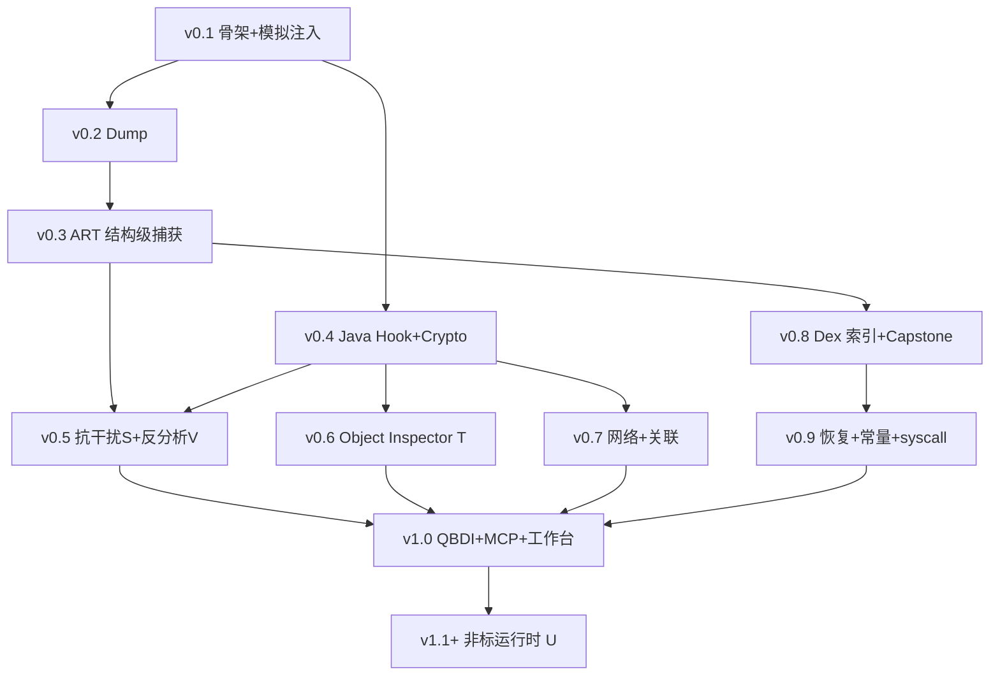

# IDH Android Runtime Workbench — 开发计划

> **定位**：**通用 Android 运行时逆向分析工具** — 对高对抗目标（反调试/root/签名检测/混淆/加密传输）具备实战能力。
> **功能需求**：见 [`REQUIREMENTS.md`](REQUIREMENTS.md)（唯一权威规格，模块 A–W；本文档只管架构与排期）。
> **跨会话进度**：见 [`PROGRESS.md`](PROGRESS.md)。
> **参考项目**：[`REFERENCE_IOS.md`](REFERENCE_IOS.md)（[ios-decrypt-helper](https://github.com/taisuii/ios-decrypt-helper)）。
> **一句话**：运行在目标进程内的 native agent，配合本机 daemon、Web UI 和 MCP Server，实现运行时 dex/so/memory dump、ART 结构级脱壳、Java/native hook、明文边界加密观测、活体对象自省、反分析行为观测、函数/指令 trace、Capstone 反汇编与搜索；root（Zygisk）+ 非 root（Gadget/重打包）双注入。

---

## 0. 核心原则（架构红线）

```text
目标 App 进程（libidh_agent.so）：
  最小侵入、低内存、低阻塞 —— hook / trace / dump / 事件采集 / 轻量 RPC

独立守护进程（idhd）：
  HTTP / WebSocket / MCP / 数据库 / 索引 / 任务调度 / 反汇编缓存 / 重分析

Web UI（浏览器）：
  局域网观测台 —— 搜索、下发任务、查看 trace/dump/反汇编结果
```

**禁止**：把 HTTP 服务、WebSocket、MCP、数据库、反编译、Capstone、QBDI 全塞进目标 App 进程。  
否则目标 App 极易 OOM、ANR、崩溃，且易被目标进程自身逻辑干扰。

**项目成败三要素**：

1. Agent 轻量、稳定、可控
2. Daemon 负责重活、索引、Web、MCP
3. 所有高风险功能支持过滤、限流、开关、回放

---

## 1. 总体架构

```text
┌────────────────────────────────────────────┐
│              Web UI / Browser              │
│  http://手机IP:端口                         │
│  - 进程列表 / Dex / SO 列表                │
│  - Trace 视图 / Dump 管理                │
│  - 反汇编 / 搜索 / 跳转 / Hook 配置        │
└─────────────────────▲──────────────────────┘
                      │ HTTP / WebSocket
                      │ MCP Streamable HTTP
┌─────────────────────┴──────────────────────┐
│                 idhd 守护进程               │
│  - HTTP Server + WebSocket                 │
│  - MCP Server (Streamable HTTP + SSE)      │
│  - Session Manager + Task Scheduler        │
│  - SQLite / RocksDB                        │
│  - Dex Indexer + Trace Store + Dump Store  │
│  - Capstone Disasm Cache                   │
│  - Service Layer（HTTP 与 MCP 共享）        │
└─────────────────────▲──────────────────────┘
                      │ Unix Domain Socket
                      │ Shared Memory RingBuffer
                      │ Binder 可选
┌─────────────────────┴──────────────────────┐
│         目标 App 进程：libidh_agent.so      │
│  - JavaVM / JNIEnv 管理                    │
│  - ClassLoader 记录                          │
│  - Java Hook Backend (LSPlant)             │
│  - Native Hook Backend                     │
│  - QBDI Trace Backend                      │
│  - Memory Dump Backend                     │
│  - /proc/self/maps Scanner                 │
│  - Capstone 本地快速反汇编（可选、轻量）    │
│  - Event Sender + Command Receiver         │
└────────────────────────────────────────────┘
```

### 1.1 三层职责边界

| 层级 | 组件 | 做什么 | 不做什么 |
|---|---|---|---|
| L1 | `libidh_agent.so` | hook、trace、dump、maps 扫描、事件推送、执行 RPC 命令 | HTTP/MCP、DB、索引、smali 生成、大量反汇编缓存 |
| L2 | `idhd` | Web/MCP 服务、会话、调度、存储、索引、分析、缓存 | 注入目标进程、直接读目标内存 |
| L3 | Web UI | 观测、搜索、配置、可视化、导出 | 业务逻辑、直连 Agent |

### 1.2 外部依赖

| 库 | 角色 | 部署位置 |
|---|---|---|
| [LSPlant](https://github.com/LSPosed/LSPlant) | ART Java method hook/unhook、inline deoptimization | Agent |
| [Capstone](https://github.com/capstone-engine/capstone) | 反汇编引擎 | Daemon 为主；Agent 可选轻量 wrapper |
| [QBDI](https://github.com/QBDI/QBDI) | DBI 框架，指定范围 instruction trace | Agent（按需加载） |
| [Frida Gadget](https://frida.re) | 非 root 注入 so（随 APK 加载 / 重打包） | 打包进目标 APK |
| Zygisk (Magisk) | root early-inject 后端 | 注入器（root） |
| MCP Streamable HTTP | 独立进程 HTTP POST/GET + SSE 流式 | Daemon |

### 1.3 Service Layer 统一入口

```text
Web UI → HTTP Controller ─┐
                          ├→ Service Layer → Agent RPC
MCP Client → MCP Adapter ─┘
```

HTTP API 与 MCP tools **不重复实现业务逻辑**，共享同一 Service Layer。

---

## 2. 八大核心模块

```text
IDH Android Runtime Workbench
├── 1. Agent 注入层          — Zygisk(root) / Gadget·重打包(非 root) / 模拟注入(CI) / 手动 inject
├── 2. Dump Engine           — dex / so / memory / maps / magic scan / ART 结构级捕获(L.6)
├── 3. Syscall / libc / File Monitor — Java + native 文件/系统观测；direct syscall 分级(E.9)
├── 4. Java Hook Engine      — LSPlant，crypto(明文边界)/file/device 模板
├── 5. Native Trace Engine   — QBDI，函数/基本块/指令级 trace
├── 6. Disasm / Binary Analyzer — Capstone，symbol/xref/asm 搜索；native crypto 常量扫描(H.4)
├── 7. Control Server / MCP Server — idhd 守护进程；自观测/审查日志(P)
└── 8. Web UI + 沙盒测试 App — 观测台 + 自动化验证

对抗与自省专项模块（贯穿上面各层）：
├── S. 抗干扰采集（诊断 + 韧性）          T. 活体对象自省
├── U. 非标运行时识别                     V. 反分析行为观测（调试/root/签名/模拟器）
└── W. 注入后端与打包（Zygisk + Gadget/重打包 + 模拟注入）
```

---

## 3. libidh_agent.so — Runtime Agent 职责

so 不是单纯 hook 库，而是 **执行端 Runtime Agent**。数据最终存储在 idhd，不在 so 内堆积。

```text
libidh_agent.so
├── bootstrap
│   ├── 初始化日志
│   ├── 初始化 Unix socket → idhd
│   ├── 获取 pid / uid / packageName
│   ├── 获取 JavaVM
│   └── 注册各子模块
│
├── runtime
│   ├── maps scanner
│   ├── module scanner
│   ├── classloader tracker
│   ├── thread registry
│   └── signal / crash guard
│
├── hooks
│   ├── Java hooks via LSPlant
│   ├── libc / bionic hooks
│   ├── linker / dlopen monitor
│   ├── file I/O monitor
│   └── crypto API monitor
│
├── dump
│   ├── dex dump
│   ├── so dump
│   ├── memory region dump
│   ├── maps dump
│   └── string / magic scan
│
├── trace
│   ├── function trace
│   ├── basic block trace
│   ├── instruction trace (QBDI backend)
│   └── 过滤 / 限流 / 采样
│
├── disasm (可选轻量)
│   ├── Capstone wrapper（单地址/小范围，结果立即送出）
│   └── 不做大规模缓存
│
└── rpc
    ├── command receiver
    ├── event sender
    ├── ring buffer writer
    └── binary payload channel（大文件走 shm fd）
```

---

## 4. 模块详细设计

### 4.1 Dump Engine

#### MemoryRegion 抽象

```text
MemoryRegion {
  start, end, perms, offset, dev, inode, pathname
  type: heap | stack | anon | dex | oat | vdex | so | apk | ashmem | dalvik
  tags: string[]
}
```

**HTTP API（经 idhd 暴露）**：

```text
GET  /api/process/maps
POST /api/memory/read
POST /api/memory/dump
POST /api/memory/search
POST /api/memory/scan_magic
```

**Magic 扫描**：`dex\n03[5-9]`、`cdex`、`ELF`、`PK\x03\x04`、`oat`、`vdex`

#### Dex Dump 来源

```text
1. base.apk / split.apk 内 dex
2. DexClassLoader 外部 dex/jar/apk
3. InMemoryDexClassLoader ByteBuffer
4. maps 内存 magic 扫描
5. ART DexFile 关联结构定位
```

**Dump 后流水线（在 idhd 执行）**：

```text
dump dex → sha256 去重 → header/checksum 修复(可选)
         → 解析 string/type/method/class/code_item
         → 建立搜索索引 → Web UI 可搜
```

#### SO Dump

| 类型 | 策略 |
|---|---|
| 文件型 | maps pathname 存在 → 直接复制 |
| 内存/修复型 | 按 ELF segment 重组 r-x/r--/rw- 段 |

**元数据输出**：module name、base、load bias、segments、symbols、imports/exports、strings、可执行段 hash

#### 脱壳辅助边界

| 壳类型 | 能力 | 承诺 |
|---|---|---|
| 一代整体加固 | maps 扫描、classloader 监控、dex dump、header 修复 | ✅ 运行时完整 dex 捕获 |
| 二代抽取壳 | 类加载后 dump、方法首次执行后 dump、code_item 前后对比 | ⚠️ 部分 method body 恢复 |
| VMP 壳 | VM dispatch trace、I/O 记录、opcode handler 识别 | ❌ 不保证还原 Java |

产品文案：**支持运行时 dex 捕获、内存 dex dump、方法体恢复辅助、抽取壳分析辅助** — 不写「万能脱壳」。

---

### 4.2 Syscall / libc / File Monitor

#### Java 层（LSPlant）

```text
java.io.File / FileInputStream / FileOutputStream / RandomAccessFile
java.nio.file.Files
android.content.SharedPreferences
android.database.sqlite.SQLiteDatabase
android.provider.Settings
android.telephony.TelephonyManager
java.security.MessageDigest
javax.crypto.Cipher / Mac
```

记录字段：`event_type, timestamp, thread_id, class_name, method_name, args_summary, return_summary, stacktrace, dex_source, classloader_id`

#### Native 层

```text
open/openat, read/write, pread/pwrite, close
fopen/fread/fwrite/fclose
access/stat/lstat/fstat
mmap/munmap/mprotect
dlopen/android_dlopen_ext, dlsym
connect/send/recv
SSL_read/SSL_write (可选)
```

**Hook Backend 抽象**（PLT hook 无法覆盖 direct syscall）：

```text
HookBackend
├── plt/got hook
├── inline hook
├── linker namespace aware symbol lookup
├── dlsym/dlopen monitor
├── syscall trace (可选)
└── QBDI instrumentation
```

Web UI **必须标注事件来源**：`Java API` / `libc` / `syscall/DBI` / `可能漏检 direct syscall`

---

### 4.3 Java Hook Engine（LSPlant）

```text
JavaHookEngine
├── hook by class + method + signature
├── hook constructors / overloads
├── before / after / replace callback
├── print args / return / stacktrace
├── dump byte[] / ByteBuffer / String
├── conditional hook / one-shot hook
└── 内置模板：Crypto / File / DeviceInfo
```

**Crypto 内置模板**：

```text
MessageDigest.getInstance / update / digest
Mac.getInstance / init / update / doFinal
Cipher.getInstance / init / update / doFinal
SecretKeySpec.<init> / IvParameterSpec.<init>
Base64 encode/decode
```

**Algorithm Session 视图**：

```text
Algorithm Session #1024
├── algorithm: AES/CBC/PKCS5Padding
├── mode: ENCRYPT
├── key / iv: hex / base64
├── input / output
├── thread, java stacktrace
├── caller method, related dex method
```

---

### 4.4 Native Trace Engine（QBDI）

**过滤维度**（强制）：

```text
scope: module | address range | function | thread | duration | hit count | condition
event: call | ret | basic block | instruction | mem read/write | register snapshot
```

| 模式 | 定位 |
|---|---|
| 默认 | 函数级 trace |
| 进阶 | basic block trace |
| 高级 | 指定地址范围 instruction trace |
| **禁止默认** | 全进程 instruction trace |

```text
TraceEvent {
  timestamp, pid, tid, module, pc, symbol, event_type
  asm?, regs?, mem_access?, call_depth, correlation_id
}
```

Web UI：函数调用树、线程时间线、基本块图、指令列表、寄存器变化、内存读写热点

---

### 4.5 Disasm / Binary Analyzer（Capstone，主要在 idhd）

```text
BinaryAnalyzer
├── module list, executable regions
├── symbol table, dynamic symbols
├── imports / exports / strings
├── xrefs, branch targets, call targets
├── function candidates
└── search index (string / symbol / asm mnemonic / immediate / call target)
```

**地址模型**：

```text
Runtime Address = module_base + offset
File Offset     = ELF segment mapping
Display         = libcrypto.so + 0x345678  (优于裸绝对地址)
```

---

### 4.6 Control Server / MCP Server（idhd）

**MCP Tools 草案**：

```text
process.list / attach / detach
memory.maps / read / search / dump
dex.list / dump / search_string / search_method / disassemble_method / xref
java.hook / unhook / trace_method / crypto_watch
native.modules / symbols / disasm / trace_function / trace_range
file.watch / syscall.watch
dump.list / download
trace.start / stop / query
```

MCP Server **只放在 idhd**，不放目标进程 so。

---

### 4.7 Web UI — 实时观测台

| 页面 | 功能 |
|---|---|
| Dashboard | 目标进程、PID/UID/package、dex/so 数、hook 数、trace 状态、dump 数 |
| Dex Browser | dex 列表、class/method/string/API 搜索、xref、smali/伪 Java |
| Native Browser | module、symbols、imports/exports、strings、disasm、xref、trace 按钮 |
| Hook Center | Java/native hook、crypto/file/device 模板 |
| Trace Viewer | call tree、timeline、instruction list、register、thread filter |
| Dump Center | dex/so/region dump、下载、自动索引状态 |
| MCP Center | tool list、schema、recent calls、auth token |

**局域网安全（必须）**：

```text
默认监听 127.0.0.1
用户手动开启 LAN → 必须 token
可选：一次性访问码、IP 白名单
危险操作二次确认（dump 全内存、开启 instruction trace 等）
```

---

### 4.8 沙盒测试 App（sandbox-test-app）

每个模块必须有**确定输入 → 确定输出**的可自动化验证场景。

```text
sandbox-test-app/
├── JavaCryptoActivity      — MD5, SHA-256, HMAC, AES/CBC, RSA
├── FileIOActivity          — FileStream, SharedPreferences, SQLite
├── DynamicDexActivity      — DexClassLoader, PathClassLoader, InMemoryDexClassLoader
├── NativeActivity          — dlopen, dlsym, native AES, file R/W, call chain
├── AntiDumpMockActivity    — mmap dex-like buffer, fake header, runtime restore mock
└── TraceActivity           — hot loop, branch, nested calls, mem R/W
```

验证标准：每个 hook 可自动断言、每个 dump 可 hash 校验、每个 trace 可回放。

---

## 5. 核心数据模型

### 5.1 Dex 身份

```text
DexIdentity {
  sha256: bytes[32]
  source: BASE_APK | SPLIT | DEX_CLASS_LOADER | IN_MEMORY | MEMORY_SCAN
  class_loader_id: u64
  load_path: Option<String>
  captured_at: timestamp
  size: u64
  pid: u32
}
```

### 5.2 索引缓存（idhd 内，按需）

```text
dex_sha256 + method_idx  -> smali
dex_sha256 + method_idx  -> pseudo_java
dex_sha256 + string_idx  -> used_by_methods[]
dex_sha256 + method_idx  -> callers[] / callees[]
module + offset          -> capstone_asm_cache
```

### 5.3 Agent 事件流

```text
Event {
  type: CLASS_LOADER | DEX_LOADED | JAVA_HOOK | CRYPTO | FILE_IO | NATIVE_IO
      | JNI | MEMORY_DUMP | MAPS | TRACE | DLOPEN
  pid, tid, timestamp_ns, stack_trace[]
  source: JAVA | LIBC | SYSCALL | DBI
  payload: oneof { ... }
}
```

### 5.4 Ring Buffer

- Agent：mmap ring 4–16 MB，满则覆盖
- idhd：独立线程 drain → SQLite / 文件 / WebSocket 推送
- 高吞吐事件默认带过滤器，全量 trace 需显式开启且二次确认

---

## 6. 工程目录

```text
android-decrpthub/          # 仓库名；产品名 IDH Workbench
├── agent/                  # libidh_agent.so
│   ├── CMakeLists.txt
│   ├── src/
│   │   ├── bootstrap/       # 双入口：JNI_OnLoad + idh_agent_start()
│   │   ├── rpc/
│   │   ├── hooks/          # java / native / libc
│   │   ├── dump/           # + art_dexfile/ (L.6 结构级捕获)
│   │   ├── trace/          # qbdi backend
│   │   ├── disasm/         # 轻量 capstone wrapper
│   │   ├── maps/
│   │   ├── object/         # T 活体对象自省
│   │   ├── detect/         # V 反分析行为观测
│   │   ├── resilience/     # S 抗干扰（诊断+韧性）
│   │   └── common/
│   └── third_party/        # capstone, qbdi, lsplant (git submodule)
│
├── injector/               # W 注入后端
│   ├── zygisk/             # root early-inject 模块
│   ├── gadget-pack/        # 非 root：agent+gadget 打进 APK 重签
│   └── ptrace/             # 手动注入器
│
├── daemon/                 # idhd
│   ├── src/
│   │   ├── http/
│   │   ├── mcp/
│   │   ├── rpc/            # agent 连接管理
│   │   ├── storage/        # sqlite / rocksdb / dump files
│   │   ├── dex_indexer/
│   │   ├── trace_store/
│   │   ├── disasm/         # capstone + cache
│   │   └── services/       # 共享 service layer
│   └── config/
│
├── web/                    # Web UI (React/Vue/Svelte)
│   ├── src/pages/
│   ├── src/components/
│   ├── src/api/
│   └── package.json
│
├── sandbox-app/            # 全模块可验证宿主 + 模拟注入自加载
│   ├── app/                # 含 AntiDebug/Packer/NativeCryptoStripped/ObfuscatedFlow/HeapObject/Detection Activity
│   ├── native-lib/
│   └── dynamic-dex-sample/
│
├── proto/                  # Agent ↔ idhd 协议
├── tools/
│   ├── pack_agent.py
│   ├── symbol_parser.py
│   ├── dex_repair.py
│   └── trace_convert.py
│
├── docs/
│   ├── DEVELOPMENT_PLAN.md
│   ├── architecture.md
│   ├── rpc.md
│   ├── mcp-tools.md
│   ├── dump-engine.md
│   ├── trace-engine.md
│   └── threat-model.md
│
└── tests/
    ├── unit/
    ├── integration/
    └── device/
```

---

## 7. 版本路线图

按版本迭代，不一口气全写。

> 路线按**取证成败价值**排序：明文边界观测 + ART 抽取 + 抗干扰存活 + 网络关联是核心闭环；QBDI 指令 trace 是拔高，放后。

### v0.1 — Agent + idhd + Web 骨架 + 模拟注入 + 自审计

```text
- libidh_agent.so 双入口（被注入 / 宿主 dlopen 主动加载）
- package / pid / uid 获取；Unix socket 连接 idhd
- /proc/self/maps 枚举 + module 列表
- crash guard + 自审计日志(P) 骨架（目标流/AUDIT 流分离）
- 模拟注入(W)：sandbox-app dlopen 加载 agent，建立可验证回路
- idhd 最小 HTTP + Web Dashboard 显示进程在线
```

### v0.2 — Dump Engine

```text
- maps region dump；ELF region dump + so 重组
- dex magic scan + dex dump；dump 文件管理 + Web 下载
- DexIdentity 去重
```

### v0.3 — ART 结构级 Dex 捕获（提前）

```text
- ClassLinker/DexCache 遍历，Class↔DexFile 关系
- DexFile begin/size dump；与 magic scan 交叉校验
- 按 API level resolver（优先 SDK 36）；结构探测报告
- Dex 恢复状态标记
```

### v0.4 — Java Hook + Crypto 明文边界观测（主武器）

```text
- LSPlant 初始化；hook 指定 Java 方法（参数/返回值/stacktrace）
- Crypto 模板（Cipher/MessageDigest/Mac/Base64），明文边界拿 key/iv/明文
- Algorithm Session 面板；流式拼包
- 文件/系统监听基础（Java File API + libc open/read/write + dlopen/dlsym，来源标注）
```

### v0.5 — 抗干扰采集(S) + 反分析行为观测(V)

```text
- S 诊断层：hook 后端可用性、maps 自扫描/ptrace/seccomp 探测、兼容性报告
- S 韧性层：early-inject、最小侵入模式、hook 自校验对抗（默认关闭）
- V：调试/root/签名/模拟器/完整性检测观测 + 检测手段清单 + 行为分叉标注
- 验证：AntiDebugMock / DetectionActivity / PackerMock
```

### v0.6 — Runtime Object Inspector(T)（提前于 QBDI）

```text
- 按 class 枚举活体实例；字段读取；object_id
- 堆内 String/byte[]/Map 搜索；低风险 getter 调用
- 与 Hook 事件联动展开对象；Object Inspector 页面
```

### v0.7 — 网络监控 + 网络↔crypto 关联（取证闭环）

```text
- Java 网络（HttpURLConnection/OkHttp/Retrofit/WebView）请求响应配对
- native SSL_read/SSL_write 明文
- correlate_request：网络 ↔ crypto 时间窗+线程关联
- ObfuscatedFlow 端到端验收
```

### v0.8 — Dex 索引搜索 + Capstone / Native Browser

```text
- dex parser + string/class/method index + invoke/const-string xref
- method smali 按需生成；Dex Browser 页面
- module/address disasm + function candidate + asm 搜索；Native Browser 页面
```

### v0.9 — Method Body Recovery + native 常量扫描 + direct syscall

```text
- L.7 被动恢复 + 受控触发（分级，非全量 invoke）
- H.4 stripped native crypto 常量签名扫描；H.5 字符串解密例程观测
- E.9 direct syscall L1 检测 + L2 DBI 观测
```

### v1.0 — QBDI Trace + MCP + 完整工作台

```text
- QBDI 指定函数/地址范围 trace（过滤/限流/采样）；Trace Viewer
- MCP Streamable HTTP + 全套 tool schema + 与 HTTP 共享 Service Layer + auth token
- 沙盒全覆盖 + device test 全绿；权限控制 + session 录制/回放；数据导出
```

### v1.1+ — 非标运行时识别(U)

```text
- Flutter / Unity(il2cpp) / RN(Hermes) 识别与观测入口（不进 MVP）
```

---

## 8. 版本依赖关系



**MVP 取证闭环（≈ v0.3 + v0.4 + v0.5 subset + v0.7 subset）**：

```text
模拟注入 → ART 结构级 dump 运行时真实 dex（对抗混淆/加固）
        → 明文边界 hook 拿 key/iv/明文（对抗加密）
        → 抗干扰诊断确认 AntiDebugMock 下采集不中断（对抗反调试）
        → 网络↔crypto 关联，把密文对应到明文与调用方
        → 全程走审计日志，可复现可维护
```

---

## 9. 技术边界（产品文案必须写清）

### 能稳定做

- maps 枚举、dex/so/memory dump
- Java API hook、加密 API 观测
- 文件读写观测（带来源标注）
- 指定范围 native trace
- Capstone 反汇编、Web/MCP 控制

### 不能承诺 100%

- 所有壳都能脱
- 所有 native 函数都能 hook 到（direct syscall、静态链接、内联封装）
- 全进程 instruction trace 不影响性能
- stripped so 函数边界全部准确
- VMP 壳还原 Java
- 所有 Android 版本 ART 结构完全一致

**推荐产品描述**：

```text
通用 Android 运行时逆向分析工具：运行时观测、按需 trace、
dex/so/memory dump、ART 结构级脱壳辅助、活体对象自省、
明文边界加密观测、反分析行为观测、Java/native 分析工作流；
root（Zygisk）与非 root（Gadget/重打包）双注入路径。
```

### 9.1 高风险能力可行性论证

对每个高风险能力给出机制 / 可行性 / 风险 / 验证点 / 兜底：

| 能力 | 机制 | 可行性 | 主要风险 | 验证点 | 兜底 |
|---|---|---|---|---|---|
| 明文边界 crypto hook | LSPlant hook Cipher/Mac；native EVP/SSL inline hook | **高** | native 静态链接+strip 时符号落空 | JavaCrypto/NativeCryptoStripped 断言 key/iv/明文 | 走 H.4 常量扫描定点 |
| 网络↔crypto 关联 | 同线程+时间窗+correlation_id | **高** | 跨线程异步加密后发包 | ObfuscatedFlow 端到端配对 | 放宽进程级弱关联+人工确认 |
| ART 结构级 dex dump | ClassLinker/DexCache/DexFile 取 begin/size | **中高** | ART 结构随版本变、CompactDex | PackerMock 多 API level 对拍 hash | 退回 magic scan + header 修复 |
| 抗干扰存活(S) | early-inject、最小 footprint、hook 自校验对抗 | **中** | 无法保证对抗所有商用加固 | AntiDebugMock 覆盖 ptrace/maps/序言校验 | 诊断层先报"打不过"，切最小侵入 |
| 活体对象自省(T) | JNI + ART 堆遍历，枚举+字段读取 | **中高** | 大堆全扫性能、GC 一致性 | HeapObjectActivity 断言字段值 | 限定 class + 数量/深度上限 |
| 反分析观测(V) | hook 目标的 ptrace/su/签名/属性检查点 | **中高** | direct syscall 检测漏检 | DetectionActivity 断言检测清单命中 | 配合 E.9 syscall 热点检测 |
| direct syscall 覆盖(E.9) | svc 扫描 + DBI 观测 | **中**(观测)/**低**(拦截) | 拦截高风险易崩 | sandbox direct-syscall mock | 只做 L1/L2，L3 不进默认 |
| 受控 method 触发(L.7) | 单方法反射/ArtMethod invoke | **中** | 触发业务副作用/自毁 | 仅 sandbox 启用 | dry-run + 默认跳过危险方法 |
| QBDI 指令 trace | QBDI 指定范围 DBI | **中高** | 与 JIT/加固冲突、性能 | TraceActivity 回放调用树 | 强制过滤+限流，不做全进程 |

**结论**：主武器（明文边界观测 + 网络关联）可行性**高**，是地基；ART 抽取与活体自省**中高**，是差异化核心；抗干扰与 direct syscall **中/低**，采用"诊断先行、韧性可选、高风险仅 sandbox"分级收口，不赌"对抗所有加固"。

---

## 10. 风险与缓解

| 风险 | 缓解 |
|---|---|
| 目标 App OOM/ANR | 重活全在 idhd；Agent ring buffer 限流 |
| Web 裸奔局域网 | 默认 localhost；LAN 需 token + 白名单 |
| 全量 trace 卡死 | 强制过滤；instruction trace 二次确认 |
| PLT hook 漏检 | 多 backend 抽象；UI 标注来源与局限 |
| VMP 壳 | 辅助分析定位；不承诺 Java 还原 |
| 大数据传输 | shm fd；dex/so 落盘不传内存 |

---

## 11. 测试策略

所有验收优先走 **sandbox 模拟注入**（无需 root、确定性、CI 可跑），再上真机（Pixel 6 Pro / Android 16 / arm64）。

| 版本 | 验证方式（pass/fail 信号） |
|---|---|
| v0.1 | 模拟注入下 Agent 连 idhd；maps 条目数与 `adb shell cat /proc/<pid>/maps` 一致；Dashboard 在线 |
| v0.2 | AntiDumpMock + DynamicDex；dump hash 对照 |
| v0.3 | PackerMock（含 InMemoryDex）；ART 结构 dump 出的 dex hash 与已知样本一致 |
| v0.4 | JavaCryptoActivity 全算法；明文边界 key/iv/明文 自动断言 |
| v0.5 | AntiDebugMock 下采集不中断；DetectionActivity 检测清单命中断言 |
| v0.6 | HeapObjectActivity 活体对象字段值断言 |
| v0.7 | ObfuscatedFlow 端到端：密文↔明文↔调用方配对断言 |
| v0.8 | 已知 dex xref 对照 + 已知 so symbol/disasm 对照 |
| v0.9 | NativeCryptoStripped 常量扫描命中 + inline hook 拿 key |
| v1.0 | TraceActivity 调用树回放；device test suite 全绿 |

---

## 12. 里程碑时间表（参考，单人全职）

| 版本 | 内容 | 目标周 |
|---|---|---|
| v0.1 | 骨架 + 模拟注入 + 自审计 | W2 |
| v0.2 | Dump Engine | W5 |
| v0.3 | ART 结构级 Dex 捕获 | W8 |
| v0.4 | Java Hook + Crypto 明文边界 | W11 |
| v0.5 | 抗干扰(S) + 反分析观测(V) | W14 |
| **MVP** | v0.3 + v0.4 + v0.5 subset + v0.7 subset 取证闭环 | W16 |
| v0.6 | Object Inspector(T) | W17 |
| v0.7 | 网络 + 关联 | W19 |
| v0.8 | Dex 索引 + Capstone | W22 |
| v0.9 | 恢复 + 常量扫描 + syscall | W24 |
| v1.0 | QBDI + MCP + 完整工作台 | W28 |
| v1.1+ | 非标运行时识别(U) | — |

---

## 13. 下一步行动（v0.1）

> 每完成一步更新 `PROGRESS.md` 并 `git commit`。工作方式：Explore → Plan → Implement → Verify。

1. **初始化 monorepo**：`agent/`、`injector/`、`daemon/`、`web/`、`proto/`、`sandbox-app/`、`tests/`
2. **proto v0**：`Ping`、`ProcessInfo`、`MapsRegion`、`Event` 骨架
3. **idhd 最小可运行**：HTTP `/health` + WebSocket + Agent 注册
4. **libidh_agent bootstrap**：**双入口**、连接 idhd、上报 pid/package、maps 枚举
5. **sandbox-app + 模拟注入**：dlopen 加载 agent，建立可验证回路（v0.1 验收信号）
6. **Web Dashboard 空壳**：显示已连接 Agent 列表
7. **敲定构建工具链**（NDK/CMake；idhd 语言）并回填 `CLAUDE.md` 的 build/verify 命令
8. **docs/threat-model.md 草稿**：Web 访问控制需求

---

## 14. 原则复述

```text
按需反编译负责「看懂代码」；
trace 负责「看真实执行」；
dump 负责「拿到运行时真实内容」；
脱壳辅助负责「把隐藏代码变成可索引 dex」。
```

```text
libidh_agent.so  — 采集与执行，越轻越好
idhd             — 分析与服务，越强越好
Web UI           — 观测与交互，实时可见
```

这就是 **IDH Android Runtime Workbench** 与 demo / 手机 jadx 的本质区别。
