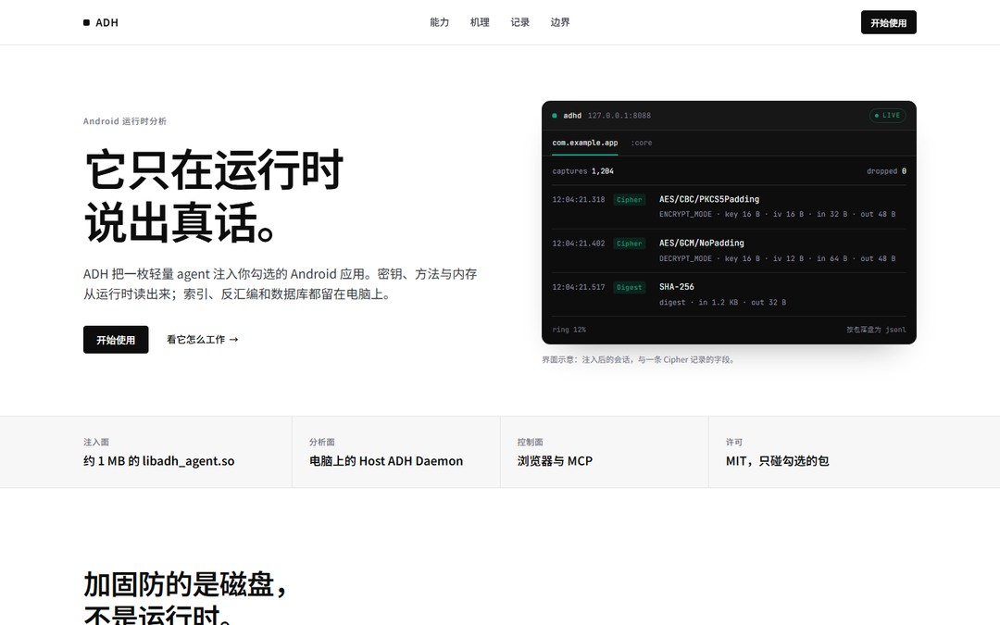

# ADH 官网

ADH（Android DecryptHub）的静态单页。没有构建步骤，没有第三方运行时：打开 `index.html` 就是一个完整的站点。



## 预览

在 `website/` 目录里起一个静态服务器（字体需要同源加载，不建议直接双击 `index.html`）：

```bash
cd website
python -m http.server 8770
# http://127.0.0.1:8770/
```

## 设计说明

**方向：OpenAI 式的黑白产品页。** 纯白画布、几何无衬线、600 字重的粗标题、细边框产品卡，以及接近纯黑的产品面板。与 Anthropic 那版的暖米色 / 衬线 / 珊瑚色不同，这一版把品牌感压在排版和产品界面上，而不是配色上。

**配色。** 白 `#ffffff`、浅灰带 `#f7f7f8`、墨 `#0d0d0d`、正文 `#353740`、灰 `#6e6e80`；绿色 `#10a37f` 只出现在深色产品面板和代码块里，白底文字用 `#0b7a5f` 保证 AA。没有第二个强调色。

**字体。** 只用思源黑体：400 正文、500 标签与按钮、600 标题与产品名；数据与命令用 JetBrains Mono。三档子集化后共约 278 KB，自托管，不请求 Google Fonts。

**版式。** 1200 栅格、64px 吸顶导航、96–112px 章节留白、发丝线、4px 控件 / 8px 卡片 / 12px 面板圆角。首屏是左右分栏：左侧粗标题与 CTA，右侧深色 `adhd` 控制台；下方浅灰数据带；能力区 3×2 白卡；机理四步 + 深色命令块；记录是七格暗色表格；边界双栏；上手是步骤加吸顶需求卡。

**产品面板。** 首屏控制台和记录表都是**界面示意**，不是截图：字段结构取自真实采集记录，数值是示例，页内有一行小字注明。

**动效。** 滚动进入时 12px 上移 + 淡入，状态点呼吸；全部 CSS 加 IntersectionObserver，`prefers-reduced-motion` 下关闭。

## 目录

```
index.html            页面
assets/css/site.css   全部样式
assets/js/site.js     滚动进入、复制按钮
assets/img/og.jpg     1200×630 分享卡
assets/fonts/         sans 400/500/600 + mono
tools/gen_assets.py   生成分享卡
tools/build_fonts.py  按页面实际用字重新子集化字体
tools/fetch_fonts.py  下载上游字体到 .cache/
tools/shoot.mjs       用 DevTools 协议截图（验收用）
```

## 改文案之后

页面里的字是从 `index.html` 实际扫出来的。**只要改了文案，就重跑字体子集**，否则新字会掉回系统字体：

```bash
python tools/fetch_fonts.py     # 只需一次
python tools/build_fonts.py
```

分享卡也要重生成：`python tools/gen_assets.py`。

## 内容口径

能力、边界与命令来自仓库的 `README.md` 与 `docs/FEATURE_STATUS.md`，没有写未经验证的承诺。改产品口径时同步改这里，尤其是：

- 只支持 arm64-v8a、必须有 root + Zygisk；
- 16 个并发 hook 槽；
- Keystore 密钥为空、分片 `update()` 的输入/输出缺口；
- 8088 / 8761 无鉴权、监听所有网卡；
- 硬件写观察点需要 SELinux permissive。

## 部署前

`og:image` 目前是相对路径。挂到正式域名后改成绝对 URL（`https://<域名>/assets/img/og.jpg`），否则部分分享卡片取不到图。静态托管把 `website/` 整个目录丢上去即可，不需要重写规则。

## 兼容性

现代常青浏览器。`text-wrap: balance` 与 `backdrop-filter` 是渐进增强，不支持的浏览器退化为普通换行与不透明导航。字体与图片全部本地化。

## 许可

字体为 SIL Open Font License（Noto Sans SC、JetBrains Mono）。页面代码随仓库使用 MIT。视觉语言参考 OpenAI 公开的品牌与产品界面，未使用其字体、图标或界面素材。
